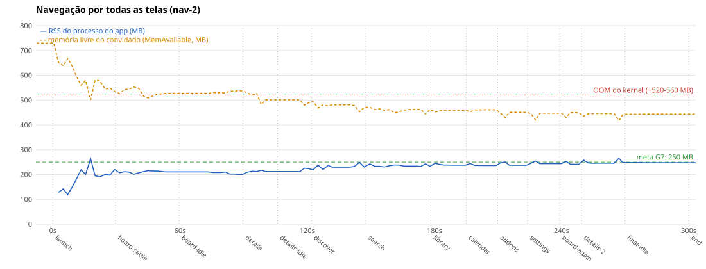
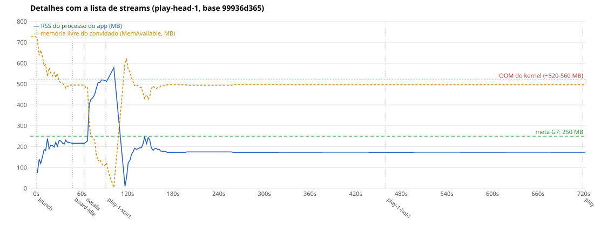
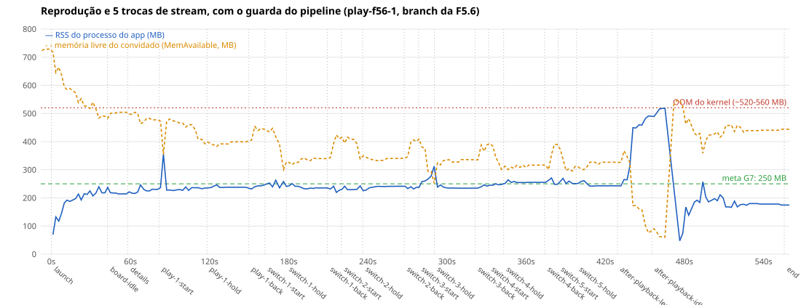

# Perfil C8: baseline do app no emulador (F7.1) e o perfil de CPU (F0.9)

Este documento tem duas partes:

1. **Medições do app no perfil C8 (F7.1)**: boot até o Board, navegação, memória (e o estouro de memória que mata o renderer), trocas de stream, o core em wasm2js × WASM e o tamanho do build. É a linha de base da F7.2 (otimizações), da F7.3 (resistência) e do G7.
2. **O perfil C8 (F0.9)**: como a cota de CPU do emulador é aplicada, por que 40 %, e o baseline de CPU do próprio emulador.

Base medida: `origin/webos` em `99936d365` (F4.1c; sem a F4.3 e sem a F5.6 mergeadas), IPK do `pnpm webos:package`, emulador webOS TV 4.0 com `--profile c8` (2 vCPUs, 1 GB, CPU limitada a 40 % de um núcleo do host). **O perfil estima, não reproduz a C8** (parte 2): trate todo tempo daqui como um limite inferior do que a TV vai mostrar; a calibração é da Fase 8. A rede é a de verdade (Cinemeta pela internet), então os tempos que esperam catálogo carregam a variância dela.

# Parte 1: medições do app (F7.1)

## Resumo e metas do G7

| | Meta do G7 | Medido (perfil c8, host calmo) | Atinge? |
|---|---|---|---|
| Boot até o Board (1º item visível) | ≤ 10 s | **mediana 32 s** (27–37 s, n = 8); core pronto em 13 s (12–17 s) | não (3×) |
| Memória do processo do app, estável no Board | ≤ 250 MB | **201–222 MB** (média 209 MB) | sim, com folga pequena |
| Memória depois de passar por todas as telas | ≤ 250 MB | 245–255 MB (pico 262 MB) | no limite |
| Memória no boot (pico) | – | 240–293 MB (mediana 272 MB) | acima de 250 MB por alguns segundos |
| Memória com a lista de streams, a reprodução e as trocas | ≤ 250 MB, sem OOM | **salta para 500–580 MB e o kernel mata o renderer** em cerca de metade das rodadas com wasm2js (ver "O estouro de memória") | **não** |

O que mais importa para a F7.2, em ordem:

1. **O estouro de memória** (+250–300 MB em segundos, OOM do kernel, o app reinicia): aconteceu em 6 de 12 rodadas com Detalhes + streams + reprodução em wasm2js, e em 0 de 6 com o core em WASM. Nada do que o app mede (heap JS, DOM, imagens, camadas, memória do core) cresce junto: é memória nativa do processo, com a thread do worker do core ocupada.
2. **O core em wasm2js é o gargalo de CPU depois do boot**: abrir a lista de streams leva 7–15 s (WASM: 1,2–3,6 s) e o 1º play 33–47 s (WASM: 18–28 s). O WASM, por outro lado, gasta ~21 s compilando e só deixa o core pronto aos 28 s. No boot os dois empatam (Board em ~32 × ~35 s).
3. **O que enche o boot**: 5,7 s para carregar e interpretar o `main.js` (9 MB, antes do core começar), 4 s para o wasm2js (9 MB de JS no worker), ~16 s do Board montado ao 1º item no DOM (catálogos pela rede e o core em JS processando) mais ~4 s até o 1º quadro com item visível, e o resto em montar o Board.
4. A tela de Detalhes leva 2,6 s para abrir na primeira vez (0,5 s nas seguintes) e 5,5 s para a prévia completa; Discover leva 6–8 s para mostrar itens.

## Como ler os números (método e confiabilidade)

**O host é compartilhado** com outros agentes e emuladores (4 instâncias do pool, builds, testes). Cada rodada registra, antes e depois, `uptime`/carga, quantas instâncias do pool outros processos seguravam, a frequência da CPU e um laço de referência de CPU (`hostRefMs`, ≈ 580 ms com um núcleo livre) em `context-*.json`. O critério de **rodada calma** é: carga de 1 min ≤ 8 (o número de CPUs do host) e `hostRefMs` ≤ 850 ms, nas duas pontas. `summarize.mjs` tira as rodadas que não são calmas das medianas; todos os números abaixo são de rodadas calmas, salvo quando dito. Faixas são mínimo–máximo entre rodadas.

Quanto confiar:

- **Tempos de CPU do app (core pronto, boot do core, tempos dos passos de navegação)**: confiáveis. Três rodadas independentes de navegação deram o mesmo número com ± 0,1–0,3 s; o core pronto varia 12–17 s em rodadas calmas.
- **Boot até o Board**: confiáveis dentro de **± 4 s**. Calmas: 27–37 s. O que faz o tempo variar dentro dessa faixa é a rede (o 1º item espera o catálogo do Cinemeta) e o escalonamento do host.
- **Rodadas em host ocupado inflam o boot em 8–15 s** (e mais com a carga acima de 15). O critério acima (carga e laço de CPU) não pega tudo; por isso `context.sh` registra também a pressão de CPU (`/proc/pressure/cpu`, `psiCpu`), que passou a entrar nas rodadas feitas depois (ver `--max-psi` no `summarize.mjs`). **Versões só se comparam em A/B intercalado na mesma reserva** (`ab-boot.sh`), nunca em reservas de horários diferentes.
- **A VM envelhece dentro de uma reserva.** Em quatro reservas de A/B com 16 instalações e 32 lançamentos no mesmo boot da VM (instalar, lançar duas vezes e remover o app, 16 vezes), as instalações 12 a 15 (lançamentos 23 a 30) ficaram 10–30 s mais lentas (core pronto 21–28 s, Board 47–69 s) **com a carga do host em 3–5 e o laço de CPU normal**, nas quatro reservas, em horários diferentes; os mesmos builds davam 29–40 s na 1ª metade. Nas reservas de 5 lançamentos (boot) o efeito não aparece. Regra: no máximo ~16 lançamentos (8 instalações) por boot da VM (o ABBA, com 16 lançamentos, não mostrou o efeito), e a ordem dos builds num A/B tem de se alternar (ABBA), nunca repetir a mesma sequência.
- **Memória**: o RSS do processo do app (kernel, `/proc/<pid>/status`, amostra a cada 2 s) é confiável para ± 5 MB em regime; o pico entre amostras de 2 s pode ser maior que o medido. O `performance.memory` do Chromium 53 é quantizado e não vê memória nativa: serve só para o heap do V8.
- **Mídia**: só a 1ª mídia depois do boot é estável no emulador (às vezes nem ela). Nas rodadas sem o guarda do pipeline (F5.6), a 2ª mídia trava em 100 % (`readyState 0`) e nenhuma troca de stream completa.

Os números absolutos valem **para o perfil c8 deste host**; a C8 real pode ser mais lenta (parte 2) ou mais rápida em decodificação (GPU/decodificador de hardware que o emulador não tem).

## Boot até o Board

Cada lançamento a frio: `ares-launch --close`, 8 s de espera, `ares-launch`; sonda por CDP com as mesmas definições da F1.6/F3.6 (`coreReadyAt` = `window.core` atribuído; `firstRowAt` = 1º quadro com um item de catálogo do Board dentro da tela). `--warmup 1`: o 1º lançamento depois de instalar roda sem o cache de código do Chromium e é descartado. Linha do tempo na página (`performance.now()`, desde a criação da página):

| Marco (mediana, faixa; rodadas calmas, n = 8) | wasm2js (padrão) | WASM (`webos.coreVariant=wasm`, n = 6) |
|---|---|---|
| `DOMContentLoaded` (parse do `main.js`, 9 MB) | 5,7 s (5,3–7,2) | 6,0 s (3,6–6,6) |
| início do init do core | 5,9 s (5,5–7,4) | 6,3 s (4,0–6,9) |
| **core pronto** | **12,8 s** (11,6–16,9) | **28,2 s** (27,4–32,6) |
| Board montado | 16,0 s (14,5–20,6) | 29,7 s (28,5–34,1) |
| 1º item do Board no DOM (marca do app) | 28,6 s (22,6–34,0) | 35,0 s (32,0–38,4) |
| **1º item do Board visível** (sonda) | **32,4 s** (26,6–37,1) | **35,2 s** (33,3–42,5) |
| tempo de relógio do host, `ares-launch` → Board | 33,5 s (28,2–43,9) | 36,6 s (34,9–43,8) |

Do core pronto ao 1º item visível passam ~20 s com wasm2js e ~6 s com WASM: depois do init, o resto do boot (catálogos do Cinemeta, `getState` a cada evento, renderização) é CPU do core, e o wasm2js é bem mais lento que o WASM nisso. O 1º item do DOM (marca do app) aparece ~4 s antes do 1º quadro com item visível da sonda.

Rodadas em **host ocupado** (carga 10–18 do host): core pronto 16,8 s (13,3–18,0) e Board 39 s (32–46 s), n = 8. Nas rodadas calmas mais quietas (carga 2–6): core 11,6–13,8 s e Board 26,6–33,3 s.

Comparação com as medições anteriores: F1.6 (c8, final): core 9,9–13,9 s, Board 24,2–34,1 s; F4.2: Board 41 s (mediana, "ruído do host 33–47 s"). Estas rodadas calmas (Board 27–37 s) caem em cima da faixa da F1.6; o 41 s da F4.2 é o de host ocupado. O diagnóstico está abaixo.

## Diagnóstico da dívida "boot c8 ~41 s na F4.2 contra 26–34 s na F1.6"

**Conclusão: carga do host, não regressão de merge.** Três evidências:

1. **A/B de dois builds, F1.6 (`1ea7951b3`) × base atual (`99936d365`), ordem alternada (ABBA) em 2 reservas, 8 lançamentos de cada** (carga do host 2,2–8,6; pool com 3 instâncias de outros): core pronto **12,7 s** (10,1–16,2) × **13,4 s** (12,6–16,1); 1º item do Board **30,3 s** (26,4–37,7) × **32,4 s** (29,5–41,8). A base atual leva ~2 s a mais na mediana, com as faixas se cobrindo por inteiro: **dentro do ruído** (± 4–5 s), e longe dos 7–15 s que separam os 41 s da F4.2 dos 26–34 s da F1.6. (`evidencias/ab/abba-7`, `abba-8`; os A/B anteriores da mesma dupla, de 5 rodadas em ordem fixa, deram 30,4 × 32,4 s nas 2 rodadas calmas de cada.)
2. **Bisect pelos 7 merges intermediários: inconclusivo por merge, sem degrau visível.** IPKs de F3.5 (`8a56cc115`), F4.2 (`30822e777`), F5.4 (`02230c019`), F3.6 (`d09004acd`), F6.3 (`17ed8e57a`), F4.1a (`fb0528387`) e da base, todos construídos do commit e rodados na mesma sequência em 4 reservas (2 rodadas de 8 builds cada). Medianas do 1º item do Board nos lançamentos da 1ª metade de cada reserva (4 por build; a carga do host caía ao longo da sequência por causa de testes de outros agentes, então a posição está confundida com a carga): F1.6 45,9 s, F3.5 44,4 s, F4.2 42,0 s, F5.4 41,0 s, F3.6 38,7 s, F6.3 35,3 s, F4.1a 40,3 s, base 35,9 s, com 0 a 3 lançamentos calmos por build (os calmos: 26–38 s). Os números **diminuem** com a posição em vez de crescer com os merges, ou seja, o que se vê é a carga, não código. Como a sequência se repetiu igual nas 4 reservas, também não dá para separar a posição do build (ver o envelhecimento da VM abaixo). O ABBA acima é a prova limpa; o bisect fino por merge só vale a pena se o ABBA mostrar diferença, e não mostrou.
3. **A carga explica os 41 s.** O mesmo IPK, na mesma máquina, em rodadas calmas e ocupadas: Board 32 s (calmas) × 39 s (carga 10–18) × 43–48 s (carga > 15, ver `boot-default-3`). As rodadas do A/B feitas com carga 15–21 deram 40–62 s para builds que, calmos, dão 29–35 s. A medição da F4.2 disse 33–47 s de ruído pelo mesmo motivo.

Um achado de método, registrado na seção de confiabilidade e que atrapalhou o bisect: **a VM envelhece dentro de uma reserva** (as instalações 12 a 15 de um mesmo boot da VM, lançamentos 23 a 30, ficam 10–30 s mais lentas com o host calmo). Como as reservas do bisect repetiam a mesma sequência de builds, os últimos da sequência (F3.6, F6.3, F4.1a) saíram 45–60 s e parecem uma regressão que não existe: o build seguinte (a base atual) volta a 35 s, e o mesmo F3.6/F6.3/F4.1a mede 29–40 s na 1ª metade da reserva. Por isso o veredito vem do A/B de **dois builds em ordem alternada** (ABBA), acima, e o bisect completo fica registrado como inconclusivo por merge (com os poucos lançamentos calmos, 26–38 s, nenhum merge mostrou degrau).

## O core: wasm2js × WASM (chave `webos.coreVariant`)

Tempos do carregador do core (`getCoreLoaderStatus()`, lidos na tela de diagnóstico, rodadas calmas), no worker:

| | wasm2js (padrão) | WASM |
|---|---|---|
| ler o arquivo | (junto da carga) | 0,11 s (0,10–0,20) |
| **carregar/compilar** | `wasm2jsLoadMs` **3,9 s** (3,3–5,5): baixar e interpretar 9 MB de JS | `compileMs` **21,5 s** (20,4–24,3): compilar o `.wasm` de 4,7 MB |
| instanciar | 11 ms (10–83) | 98 ms (24–116) |
| memória do core (buffer) | 7,2 MB | 6,8–7,3 MB |
| core pronto na página | 12,8 s | 28,2 s |

- **O wasm2js compila 5× mais depressa** (a compilação de WASM no V8 do Chromium 53 é lenta e não é guardada em cache), por isso o core fica pronto 15 s antes. **O WASM executa o core bem mais depressa**: lista de streams em 1,2–3,6 s (wasm2js: 7–15 s), 1º play em 18–28 s (33–47 s), e o ~6 s do core pronto ao Board (wasm2js: ~20 s). No boot, os dois empatam.
- O WASM **não** usa menos memória nesta medida: nos 25 s depois do Board o processo do app fica em média em 249 MB (wasm2js: 209 MB; `RssAnon` 170 × 125 MB: o código compilado e a compilação ainda não devolvida) e, 60 s depois, em 207–209 MB nos dois; na navegação completa termina em 244–265 MB (wasm2js: 238–248 MB). A F0.6 esperava o contrário (wasm2js com 2× a memória do WASM); o buffer do core, que seria onde está o 2×, é igual aqui (7 MB).
- **O WASM não teve nenhum estouro de memória** nas 6 rodadas com Detalhes + streams + reprodução (duas delas com 5 trocas); o wasm2js teve em 6 de 12. Ver a seção seguinte.
- Compilação isolada do core MVP (`baseline-c8.sh`, perfil c8, host com carga alta nas duas rodadas): 28,1 s numa; a outra caiu no "timeout" já documentado na parte 2 (a compilação a 40 % de cota às vezes fica ociosa até o limite de 180 s).

## Navegação

Cada passo, do evento de entrada (tecla do controle remoto, ou clique no link da barra lateral) até o 1º quadro com a tela pronta, na linha do tempo da própria página (a latência do CDP não entra). "Assenta" é o tempo até o DOM parar de mudar por 4 s. Mediana (faixa) de três rodadas, wasm2js:

| Passo | Pronto | Assenta |
|---|---|---|
| Board → Detalhes (OK no item focado), 1ª vez | **2,6 s** (2,5–2,6) | 7,0 s |
| … prévia da tela de Detalhes completa | 5,5 s (5,5–5,6) | – |
| Detalhes → Board (Back) | 1,4 s (1,2–1,5) | 1,3 s |
| Board → Discover (barra lateral) | 0,7 s (0,6–0,7) | 7,4 s |
| … 6 itens do catálogo no Discover | **7,4 s** (6,3–7,7) | – |
| Discover → Board (Back) | 1,4 s (1,1–1,8) | 1,4 s |
| Board → Busca (barra de busca) | 0,7 s (0,7–0,8) | 1,3 s |
| Busca por "matrix" até 3 resultados (rede) | 4,4 s (3,6–4,7) | 5,1 s |
| Busca → Board (Back) | 1,2 s (0,9–1,3) | 1,2 s |
| Library / Calendar / Addons / Settings | 0,5 / 0,3 / 0,2 / 0,5 s | 2,6 / 1,9 / 1,9 / 2,9 s |
| Settings → Board | 0,6 s (0,6–0,9) | 0,6 s |
| Board → Detalhes, 2ª vez | **0,5 s** (0,4–0,6) | 3,9 s |
| Detalhes → Board, 2ª vez | 1,3 s (0,7–1,5) | 1,3 s |

Com o core em **WASM** (2 rodadas, o mesmo roteiro depois do boot): Detalhes abre em **1,1 s** (2,6 s com wasm2js) e a prévia completa em 2,4 s (5,5 s), os itens do Discover aparecem em **5,3 s** (7,4 s), a busca dá resultados em 3,1 s (4,4 s), Back 1,2–1,7 s (igual), Library/Calendar/Addons/Settings 0,8 / 0,3 / 0,4 / 0,6 s. Ou seja, o WASM ganha 1,5 a 3 s nas telas que dependem do core, e a navegação termina em 244–265 MB (pico 281 MB numa rodada), sem estouro.

- A **1ª abertura de Detalhes** custa 2,6 s e a 2ª, 0,5 s (carregar o chunk lazy da rota e o JS ainda frio). O Back leva 1–1,5 s sempre.
- **Detalhes → Player**: depende da mídia e do core (próxima seção): o Player monta em 9 s (wasm2js) ou 3 s (WASM) e o vídeo toca 24–48 s depois do OK com wasm2js (18–29 s com WASM).
- Os passos de navegação de Discover/Busca dependem da rede (Cinemeta); Settings/Library/Calendar/Addons só de CPU.

## Memória

RSS do processo do app (o renderer `WebAppMgr` novo que nasce com o lançamento), amostrado a cada 2 s por SSH, com a composição do kernel (`RssAnon`, `RssFile`, `RssShmem`):

| Momento | RSS do app (mediana, faixa) | Composição (anon / file / shmem) |
|---|---|---|
| Pico no boot (lançamento até o Board) | 272 MB (240–293), wasm2js; 268 MB (243–289), WASM | 148 / 72 / 29 MB (um lançamento) |
| Estável parado no Board | **209 MB** (201–222), wasm2js; **249 MB** (230–260), WASM | 125 / 79 / 17 MB; WASM: 170 / 79 / 18 MB |
| Detalhes | 232 MB (217–240) | 100 / 78 / 24 MB |
| Discover | 237 MB (235–249) | 115 / 78 / 31 MB |
| Busca | 242 MB (240–243) | 110 / 78 / 39 MB |
| Library, Calendar, Addons | 245–248 MB | 112–116 / 78 / 40–43 MB |
| Settings | **255 MB** (249–262) | 117 / 80 / 45 MB |
| De volta ao Board, parado 30 s | 248 MB (239–248) | 120 / 80 / 47 MB |

Outros processos que crescem junto: os demais `WebAppMgr` (UI do sistema) ganham +105–150 MB desde o início do app, e o `MemAvailable` do convidado (1 GB) cai de ~780 MB para ~420–500 MB só com o app no Board. Com a lista de streams e o Player, o pipeline de mídia (`starfish-media-pipeline`) soma mais ~85 MB.

O que a navegação sozinha mostra (3 rodadas iguais, ver `mem-nav-2.svg`):



- Sem addon de streams, **a navegação não estoura**: pico de 262 MB e sem OOM em todas as rodadas.
- **`shmem` só cresce**: 11 → 47 MB no passeio, e não volta ao voltar para o Board (o DOM volta ao mesmo, 543 nós e 55 imagens). `anon` e o heap do V8 (33–43 MB) ficam estáveis (110–120 MB). É a candidata a vazamento lento para a F7.3 (imagens/decodificação compartilhada).
- O heap do V8 da página (`performance.memory`) fica em 33–43 MB o tempo todo: não explica nada do que acontece abaixo.

## O estouro de memória (o OOM que mata o renderer)

Reproduzido nas rodadas de Detalhes + streams + reprodução (addon de teste local, mídia do kit, `play.mjs`): o RSS do app salta **+250–300 MB em 5–30 s** e passa de 500 MB (579 MB o maior), o `MemAvailable` do convidado cai a ~10–30 MB, e o kernel mata o renderer. Linha do `dmesg` de uma rodada:

```
[  260.066412] WorkerPool/1702 invoked oom-killer: gfp_mask=0x24280ca(GFP_HIGHUSER_MOVABLE|__GFP_ZERO), order=0, oom_score_adj=300
[  261.873635] Out of memory: Kill process 1245 (WebAppMgr) score 834 or sacrifice child
[  261.877023] Killed process 1245 (WebAppMgr) total-vm:1090832kB, anon-rss:522936kB, file-rss:0kB, shmem-rss:23532kB
```

O app é relançado pelo sistema (RSS volta a ~170 MB, `core` indisponível por alguns segundos, o inspetor perde a página). Isso explica os "reinícios do app" e parte das travas do emulador vistas nas outras tarefas.



Frequência e momento, todas as rodadas com a lista de streams (addon de teste) e reprodução, perfil c8:

| Rodada | Core | Guarda da F5.6 | Reproduções que tocaram | Pico do app | OOM matou o renderer | Salto passou de 400 MB na fase |
|---|---|---|---|---|---|---|
| play-f56-1 | wasm2js | sim | 6 | 518 MB | **sim** | after-playback-leave |
| play-f56-2 | wasm2js | sim | 5 | 480 MB | **sim** | switch-4-back |
| play-f56-3 | wasm2js | sim | 5 | 498 MB | **sim** | switch-4-back |
| play-f56-4 | wasm2js | sim | 5 | 493 MB | **sim** | switch-4-hold |
| play-f56wasm-1 | WASM | sim | 6 | 290 MB | não | – |
| play-f56wasm-2 | WASM | sim | 6 | 288 MB | não | – |
| play-head-1 | wasm2js | não | 0 | 579 MB | **sim** | details |
| play-head-2 | wasm2js | não | 1 | 316 MB | não | – |
| play-head-3 | wasm2js | não | 1 | 316 MB | não | – |
| play-head-4 | wasm2js | não | 0 | 547 MB | **sim** | details |
| play-head-5 | wasm2js | não | 1 | 371 MB | não | – |
| play-head-6 | wasm2js | não | 1 | 251 MB | não | – |
| play-head-7 | wasm2js | não | 1 | 295 MB | não | – |
| play-head-8 | wasm2js | não | 1 | 273 MB | não | – |
| play-wasm-1 | WASM | não | 1 | 278 MB | não | – |
| play-wasm-2 | WASM | não | 1 | 302 MB | não | – |
| play-wasm-3 | WASM | não | 1 | 326 MB | não | – |
| play-wasm-4 | WASM | não | 1 | 263 MB | não | – |

Em resumo: **wasm2js 6 de 12 rodadas com OOM** (sem o guarda: 2 de 8, e `play-head-5` chegou a 371 MB sem ser morta; com o guarda: 4 de 4), **WASM 0 de 6**. As rodadas de depuração do início (`dbg1`…`dbg5`, mesma base) tiveram o mesmo padrão: 3 de 5 com salto acima de 490 MB.

- Com o **wasm2js sem o guarda da F5.6** (base `99936d365`), o salto veio **4 a 8 s depois da 1ª requisição `/stream/…` do addon**, na 1ª abertura de Detalhes (rodadas `play-head-1` e `-4`; também `dbg3` e, ao voltar a Detalhes depois da reprodução, `dbg1` e `dbg5`).
- Com o **guarda da F5.6** (que faz as 5 trocas funcionarem), o salto veio **depois da 4ª ou 5ª reprodução** (a ~290–380 s da 1ª requisição de streams), nas 4 rodadas: a memória fica estável em 235–255 MB durante as trocas e então dispara (`mem-play-f56-1.svg`).



**O que cresce.** Medido no momento do salto (`snapshots` das rodadas `play-head-4`/`play-f56-*`): `RssAnon` de 117 → 417 MB (+300 MB), `RssFile` e `RssShmem` estáveis; **heap do V8 da página 33–43 MB (não muda)**, **memória do core (buffer wasm) 7,1 MB (não muda)**, DOM 735–860 nós e 55–59 imagens (~45 MB estimados decodificados) **(não mudam)**, **camadas do compositor: 10, uma só com conteúdo (1920×1080, 8 MB) (não muda)**. Os ticks de CPU por thread do renderer durante o salto (rodada `play-head-4`, entre o Board parado e a lista de streams): o `DedicatedWorker` (o worker do core, wasm2js) +14,7 s de CPU, a thread principal +6,4 s, o `WorkerPool` (raster/decodificação) +7,5 s. O OOM é disparado pelo `WorkerPool`, que pede páginas ao kernel.

Ou seja: **o crescimento é memória nativa fora do heap da página, do core e do compositor**. Sobram o heap do V8 **do próprio worker do core** (um isolate à parte: o Chromium 53 não expõe o `performance.memory` do worker) e caches nativos de decodificação/raster. Dois fatos apontam para o worker do wasm2js: (1) com o core em **WASM, 0 estouros em 6 rodadas** (duas com as 5 trocas), contra 6 em 12 com wasm2js, e (2) o `DedicatedWorker` é a thread que mais gasta CPU durante o salto. **Não está provado**; o experimento para a F7.2 é instrumentar o worker (por exemplo, medir o heap dele com um `HeapProfiler` pela porta de inspeção do worker, que `Worker.sendMessageToWorker` alcança) ou comparar wasm2js com WASM com a mesma instrumentação.

Não reproduziu (e vale como controle): 8 ciclos de Detalhes ↔ Board com o addon por `location.hash`, sem reprodução (`streams-cycle`, wasm2js e WASM), 4 ciclos sem addon, e as 3 passagens de navegação completa sem addon.

## Reprodução e trocas de stream

Addon de teste local (`webos/tests/addon`, F6.2): streams do kit H.264 (MP4 e MKV) por `/redirect/…` (302). Tempos desde a tecla OK no stream (linha do tempo da página), perfil c8:

| | wasm2js, base `99936d365` (sem guarda) | wasm2js, com o guarda da F5.6 (branch) | WASM, com o guarda |
|---|---|---|---|
| Abrir a lista de streams (`#/detail/movie/…`) | 8,7 s (6,8–15,2), n = 8 | 7,6 s (7,2–9,1), n = 4 | 3,1 s (3,1–3,2), n = 2 |
| Player montado (OK → `<video>`) | 9,3 s | 8,7 s | 2,8 s |
| **OK → `playing`** (`readyState ≥ 3`, `currentTime > 0`) na 1ª mídia | **39 s** (24–48), n = 6; 2 falharam (OOM) | 31 s (26–44), n = 4 | **26 s** (23–29), n = 2 |
| OK → `playing` nas **trocas** (Back + outro stream) | **não completa**: 0 de 6 (a 2ª mídia trava em `readyState 0`) | **11,5 s** (7,9–20,5): 17 de 20 (3 mortas pelo OOM) | **13,1 s** (7,8–17,0): 10 de 10 |
| Back do Player até a lista de streams | 2–3 s | 1–2 s | 1,4–2,0 s |
| RSS do app durante as trocas | – | 235–255 MB | 250–270 MB |

As colunas "com o guarda" usam o IPK da branch da F5.6 (`e3373ca4a`, depois mergeada como `dcbfab71c`), construído como a base. As trocas alternam dois streams H.264 (MP4 e MKV) do kit; cada uma é Back até a lista + OK no outro stream.

- **Sem o guarda do pipeline** (F5.6), nenhuma troca de stream completa no emulador: a 2ª mídia do boot nunca passa de `readyState 0` (limite do emulador, a causa que a F5.6 mediu). Com o guarda, as 5 trocas completam.
- O tempo de **OK → `playing`** é dominado pelo core e pelo emulador (decodificação por software): 23–48 s na 1ª mídia, 8–20 s nas trocas (sem o custo do Player lazy). Na C8 real, a decodificação por hardware deve ser bem mais rápida; só a Fase 8 diz.
- **Memória durante a reprodução**: o app fica em 235–255 MB (wasm2js) ou 250–270 MB (WASM) enquanto toca e troca; o `starfish-media-pipeline` pesa ~85 MB à parte. Depois de sair do Player, o RSS do app volta a ~240 MB e o pipeline some em ~5 s.
- O OOM com o guarda vem **depois das trocas** (ver a seção anterior).

## Tamanho do build e do IPK

`node webos/tests/perf/size.mjs --dir build-webos --ipk … --compare build` (`evidencias/tamanho/`):

| | Bruto | gzip |
|---|---|---|
| **IPK** (instala em ~27 MB) | **10,1 MB** | – |
| `main.js` (parse na página: o `DOMContentLoaded` de 5,7 s) | 8,94 MB | 2,65 MB |
| core wasm2js (`stremio_core_web_bg.wasm2js.js`, carregado no worker) | 8,99 MB | 2,26 MB |
| core WASM (`stremio_core_web_bg.wasm`, só se `webos.coreVariant=wasm`) | 4,69 MB | 1,65 MB |
| CSS (`main.css`) | 0,56 MB | 0,05 MB |
| imagens (11) | 3,26 MB | – |
| `worker.js` (bridge do core) | 0,15 MB | – |
| **build desktop** (comparação, `pnpm build`): `main.js` 9,08 MB, `575.js` 8,07 MB (o core JS), wasm 4,88 MB | 43,2 MB (inclui 15,6 MB de sourcemaps) | – |

O IPK leva os dois cores (wasm2js e WASM: 13,7 MB descomprimidos); trocar a variante é só a chave. O IPK não leva sourcemaps. O desktop tem 17,2 MB de JS bruto contra 9,1 MB do webOS (sem hls.js, libass e Sentry, F1.5).

## O que a F7.2 deve atacar (ordem sugerida)

1. **O estouro de memória** (impede a meta e a F7.3): instrumentar o heap do worker do core, comparar wasm2js × WASM com a mesma instrumentação, e procurar o que dispara 4–8 s depois da 1ª resposta de `/stream/…`. Se o WASM resolve de fato, o problema é só chegar nele sem os 21 s de compilação (carregar o wasm2js primeiro e trocar por WASM compilado em segundo plano, ou reduzir o `.wasm`).
2. **O boot de ~32 s** (meta 10 s): 5,7 s de parse do `main.js` (9 MB; dividir em chunks e adiar o que o Board não usa), 4 s do wasm2js, ~20 s do core pronto até o 1º item (o core em JS processando catálogos), mais a rede. Qualquer ganho no core em JS aparece dobrado: boot e todas as interações.
3. **`shmem`** crescendo ~36 MB por passeio de navegação (F7.3).
4. Conferir na Fase 8 se a decodificação por hardware e a CPU real mudam a ordem.

## Como refazer

`webos/tests/perf/README.md` (`perf.mjs` roda tudo, `summarize.mjs` resume, `ab-boot.sh` compara builds). Dados brutos desta tarefa: `~/webos-tv-sdk/orquestrador/tarefas/F7.1/evidencias/`.

# Parte 2: o perfil C8 (F0.9)

O emulador roda a imagem oficial do webOS TV 4.0 em QEMU/KVM no PC de desenvolvimento (i7-7700HQ, até 3,8 GHz). A C8 tem uma CPU ARM bem mais lenta, então medir tempos no emulador "solto" é otimista. O **perfil C8** é um opt-in que limita a CPU da VM para o caso pior ficar mais perto da TV. Ele **estima**, não reproduz: a calibração final só acontece na Fase 8, com a TV.

## Como usar

```bash
webos/tools/emu-run --profile c8 -- <comando>           # ou EMU_PROFILE=c8
EMU_CPU_QUOTA=25 webos/tools/emu-run --profile c8 -- …   # cota diferente (% de um núcleo do host)
webos/tools/emulator-qemu.sh -i N start headless --profile c8 [--cpu-quota PCT] [--smp N] [--mem MB]
```

| | Sem perfil (padrão, inalterado) | `--profile c8` |
|---|---|---|
| RAM | 1024 MB | 1024 MB (`EMU_C8_MEM`) |
| vCPUs | `emu-run`: 2; `start` direto: 3 | 2 (`EMU_C8_SMP`) |
| Cota de CPU | nenhuma | `CPUQuota=40%` para a VM inteira (`EMU_CPU_QUOTA` ou `EMU_C8_QUOTA`) |
| Espera pelo boot no `emu-run` | 240 s | 900 s (`EMU_BOOT_WAIT`) |

Precedência: opção explícita (`--smp`, `--mem`, `--cpu-quota`) > variável de ambiente > perfil > padrão. `EMU_CPU_PERIOD_MS` (opcional) troca o período do CFS (padrão do systemd: 100 ms). `EMU_CPU_QUOTA` sem `--profile` aplica só a cota e usa a mesma espera de boot de 900 s. Dentro do comando do `emu-run`, `EMU_PROFILE=c8` fica definido. A trava `run/emu-N.lock` e o resto do protocolo do `emu-run` não mudaram.

**Como a cota é aplicada.** O `flatpak run` move o QEMU para um scope transitório próprio (`app-flatpak-org.gnome.Boxes-<id>.scope`), então um `systemd-run --user --scope -p CPUQuota=… flatpak run …` por fora **não alcança o QEMU** (medido: o processo fica no scope do flatpak). Por isso `start` espera o processo aparecer, lê o scope em `/proc/<pid>/cgroup` e roda `systemctl --user set-property --runtime <scope> CPUQuota=40%`. A cota vale para todas as threads do QEMU (vCPUs, I/O, rede) e some quando o QEMU sai. Se o scope não for o esperado, `start` mata o QEMU e falha em vez de seguir sem limite. Exige cgroup v2 com o controlador `cpu` delegado ao usuário (é o caso desta máquina).

## Justificativa da cota

- **CPU da C8: não verificada.** Não achei fonte confiável para o SoC da OLED55C8 (o "α9" é o processador de imagem). A única pista é uma planilha de hobby de uma B8 (LG1313, 4 × Cortex-A53 a ~1,0 GHz), sem confirmação. Hipótese de trabalho: núcleos ARM em ordem de 1,0 a 1,4 GHz.
- **Relação estimada com o host:** um A53 desses rende em JS de uma thread algo como 1/6 a 1/10 de um núcleo do i7 em turbo. Isso pediria cota por núcleo de 10 a 17 %.
- **O que escolhi: 40 %, a menor cota estável medida.** Com cota ≤ 25 % a compilação do core travou em parte das execuções (seção "Achado" abaixo), então o perfil não pode descer disso por padrão. 40 % de um núcleo (2 vCPUs dividindo 0,4 núcleo) dá, no JS de uma thread, cerca de **2,7×** mais lento que sem cota e, na compilação do core, cerca de **5×** com a máquina ociosa (1,9× numa rodada de revisão com carga 55: o número sem cota depende da carga; use os tempos absolutos com o perfil, que são estáveis), mais perto do que se espera da C8 do que o emulador solto, mas **ainda otimista** frente à hipótese acima. Trate os tempos do perfil como um limite inferior do tempo na TV.
- **Como recalibrar na Fase 8:** `baseline-c8.sh` mede o microbenchmark de JS (`loopMs`, `sortMs`) e a compilação do core com o mesmo código que roda na TV (via sonda). Com `loopMs` na C8 e `loopMs` do emulador sem cota (≈ 0,9 s, **medido com o host ocioso**: com a máquina ocupada o mesmo laço deu 2,9 s na revisão, então rode o de referência com a carga baixa), a cota certa é aproximadamente `100 × loopMs_emulador / loopMs_C8` (% de um núcleo). Depois é só `EMU_C8_QUOTA=<valor>`.
- 2 vCPUs: a RAM é a da TV (1 GB) e o `hardwareConcurrency` visto pela sonda passa a 2. O número de núcleos da C8 também não foi confirmado; 2 vCPUs são o que o `emu-run` já usava.

## Medições

Comandos (cada linha é uma reserva curta do pool, boot limpo, uma instância por vez):

```bash
webos/tools/emu-run --timeout 15 -- webos/tools/baseline-c8.sh none-a
EMU_CPU_QUOTA=40 webos/tools/emu-run --timeout 15 --profile c8 -- webos/tools/baseline-c8.sh c8q40-a
```

`baseline-c8.sh` mede: **boot** (idade do QEMU quando o SSH responde, precisão ~3 s), **sonda** (do `ares-package` até `__probe.complete`, via `probe-run.sh`), **JS** (laço de 30 M iterações e `sort` de 300 mil números na página da sonda, melhor de 2) e **compilação do core** MVP (`core-0.65.0-mvp.wasm`, 4,9 MB) num Worker via `wasm-compile-test.sh`. Cada execução também grava `uptime` do host (início e fim) e um laço de referência em Node no host (`host_ref_ms`; ≈ 600 ms com a máquina ociosa).

Medianas (host com 8 CPUs; saída bruta em `evidencias/baseline/results.jsonl`):

| Cota (perfil) | n | Boot até SSH | Sonda completa | JS laço (30 M) | JS sort | Compilação do core | Faixa da compilação |
|---|---|---|---|---|---|---|---|
| sem perfil (2 vCPU) | 2 | 25 s | 13,8 s | 0,89 s | 0,32 s | 5,2 s | 5,0–5,4 s |
| 60 % | 2 | 28 s | 27,6 s | 1,57 s | 0,66 s | 16,0 s | 15,8–16,2 s |
| 50 % | 2 | 31 s | 28,5 s | 2,17 s | 0,86 s | 19,5 s | 19,3–19,6 s |
| **40 % (padrão c8)** | 5 | 37 s | 38,8 s | 2,43 s | 0,8–2,3 s | 26,4 s | 25,2–26,8 s |
| 25 % | 3 | 49 s | 78,9 s | 4,10 s | 1,60 s | 46,7 s (2 de 3) | 45,1–48,2 s; **1 timeout** |

Sem perfil o `wasm-compile-test.sh` mediu 2,0 s com a máquina ociosa (PESQUISA, seção 2) e 3,5 a 6,3 s nesta bateria; veja a variância abaixo.

### Variância

Durante toda a medição o host esteve ocupado por outros agentes (load average de 20 a 47 em 8 CPUs; `host_ref_ms` entre 580 e 2440 ms contra ≈ 600 ms ocioso). Consequências:

- Os tempos "sem perfil" são os mais sensíveis à disputa: a compilação foi de 3,5 s (load 3) a 6,3 s (load 22), contra 2,0 s no spike com a máquina livre. Com a cota, o QEMU já está limitado e a disputa pesa menos: as 5 execuções a 40 % ficaram entre 25,2 e 26,8 s mesmo com load de 20 a 43.
- O sort e o laço de JS oscilam mais que a compilação (ex.: 0,8 a 2,3 s a 40 %), porque rodam em poucos ciclos de quota. Use o laço como indicador, não o sort.
- Para comparar duas configurações, rode-as intercaladas (como fiz) e olhe o `host_ref_ms` e o load de cada linha.
- A memória mínima disponível no convidado durante a compilação ficou em 527 a 580 MB em todas as configurações (a cota não muda a memória).

## Achado: compilação trava com cota baixa

Nas primeiras tentativas (limite de 600 s no `wasm-compile-test.sh`) a compilação do core **não terminou** em 4 de 6 execuções com cota de 25 % ou 40 % (`evidencias/sweep-r1.log` e `debug-cliff*.log`: "timeout aguardando a Promise"). Essas tentativas começaram a compilar antes de a sonda completar (o `probe-run.sh` espera só 40 s e a sonda leva 37 a 80 s nessas cotas), o que pode ter contribuído. Na bateria final a sonda sempre completou antes (`PROBE_WAIT=300`) e o limite era 180 s: 40 % passou 5 de 5; 25 % passou 2 de 3 (45 e 48 s) e teve 1 timeout; 50 e 60 % passaram sempre. Ou seja, a 25 % o problema persiste mesmo sem esse fator.

O que se sabe:
- Num travamento a 40 % (`evidencias/debug-cliff-q40.log`) o convidado ficou **ocioso** (WebAppMgr ~0 % CPU, cgroup sem novas limitações), ou seja, não é a compilação lenta demais. Em outro travamento a 25 %, o servidor estático do host registrou o `GET` do `.wasm` (200) e o convidado ainda tinha conexões abertas (`debug-cliff3-q25.log`).
- Um `fetch` simples do mesmo arquivo, feito da página, funcionou a 40 % (períodos de 10 e 100 ms), então a rede básica não quebra com a cota.

Hipótese (não confirmada): com a cota baixa a VM inteira, inclusive a rede (slirp) e o laço de eventos do QEMU, fica parada por ~75 % de cada período, e a transferência de 4,9 MB ou a entrega do resultado para o Worker perde um evento. Isso casa com a lembrança de que a NIC da VM "trava depois de transferências grandes" (comentário no `emulator-qemu.sh`). **Não foi diagnosticado**; fica fora do escopo. Efeito prático: o perfil c8 padrão é 40 %, e o `baseline-c8.sh` registra a compilação como `timeout` (limite de 180 s, `WASM_TIMEOUT_MS`) em vez de segurar a reserva.

## Ferramentas alteradas ou criadas por esta tarefa

- `emulator-qemu.sh`: `start --profile c8 [--cpu-quota PCT]`, `EMU_PROFILE`, `EMU_CPU_QUOTA`, `EMU_C8_*`, `EMU_CPU_PERIOD_MS`.
- `emu-run`: `--profile c8` / `EMU_PROFILE`; só nesse caso muda o `start` e a espera do boot.
- `baseline-c8.sh` (novo): medição acima.
- `wasm-compile-test.sh`: usa `$EMU_SSH_PORT` (antes fixo em 6622, só instância 0), e aceita `WASM_HTTP_PORT`, `WASM_MEM_LOG`, `WASM_TIMEOUT_MS`. Sem variáveis o comportamento é o antigo.
- `probe-run.sh`: `PROBE_WAIT` (segundos de espera pela sonda; padrão 40, como antes).
- `qmp.py`: `screendump` agora pede PPM ao QEMU e converte para PNG. O PNG do próprio QEMU saía com vermelho e azul trocados.


### Ajustes de F7.1 nas ferramentas (da revisão F0.9 c1, baixas)

- `emulator-qemu.sh`: a ajuda (comando desconhecido) imprime o cabeçalho de comentários inteiro, até o primeiro `set -`, e não mais um `sed 2,16p` que cortava as portas por instância; `--cpu-quota`/`EMU_CPU_QUOTA` só aceita inteiro maior que zero (0 era aceito e só falhava depois de o QEMU subir).
- `emu-run`: `EMU_CPU_QUOTA` sem `--profile` aplica a cota **e** usa a espera de boot longa (`EMU_BOOT_WAIT`, 900 s), em vez dos 240 s do boot sem cota.
- `baseline-c8.sh`: sem cota o `cpu_max` do JSON sai sempre `max` (antes `n/a` ou `max 100000`, conforme outro scope tivesse ligado o controlador `cpu`).
- `qmp.py`: o `.ppm.tmp` de ~6 MB é apagado também quando a conversão falha.
- Teste (sem emulador, ~5 s): `webos/tests/emu-run/tools-fixes.sh`.

