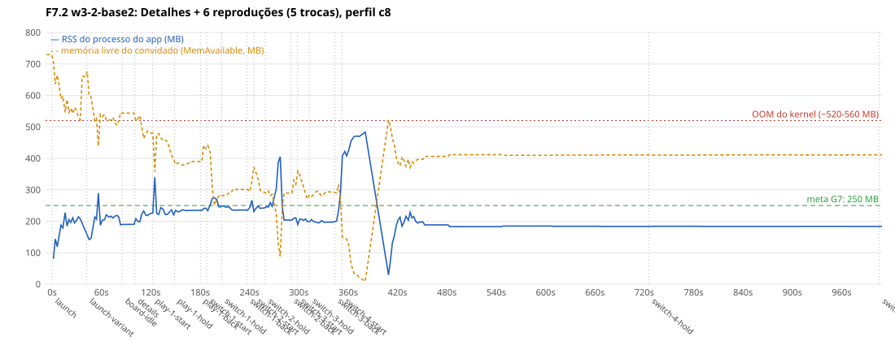
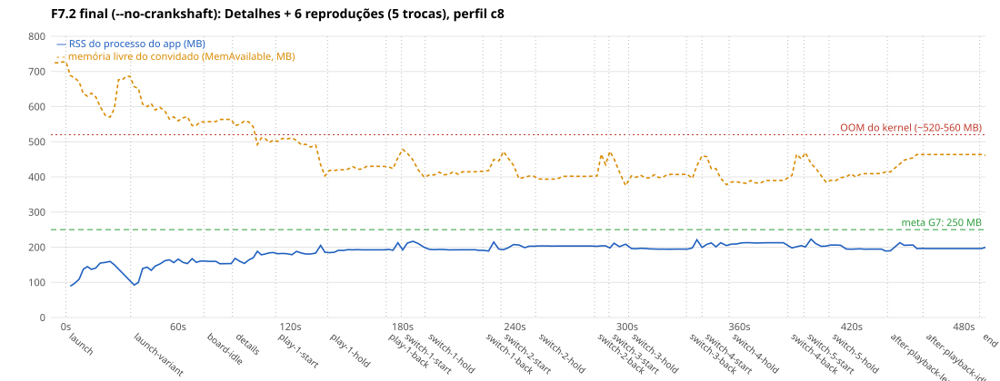

# Perfil C8: baseline do app no emulador (F7.1), as otimizações (F7.2), a resistência (F7.3) e o perfil de CPU (F0.9)

Este documento tem quatro partes:

- **Parte 1, medições do app no perfil C8 (F7.1)**: boot até o Board, navegação, memória (e o estouro de memória que mata o renderer), trocas de stream, o core em wasm2js × WASM e o tamanho do build. É a linha de base da F7.2 (otimizações), da F7.3 (resistência) e do G7.
- **Parte 1b, otimizações (F7.2)**: a causa e a correção do estouro de memória, o WASM em segundo plano (inviável no Chromium 53), o boot depois das mudanças e por que a meta de 10 s não cabe no emulador. **É o estado atual**; a parte 1 fica como a linha de base.
- **Parte 1c, resistência (F7.3)**: até 2 h 30 de navegação contínua e uma reprodução longa (50 min) por boot, sem reinício nem vazamento de objetos; o `shmem` é um preenchimento até ~90 MB e não crescimento, e sobra um crescimento de memória nativa, sem patamar (~3–9 MB/h de navegação, ~1 MB/h parado), concentrado nas telas de catálogo e sem causa localizada; **o Board em repouso depois de navegar (252–270 MB) já passa da meta de 250 MB do G7**.
- **Parte 2, o perfil C8 (F0.9)**: como a cota de CPU do emulador é aplicada, por que 40 %, e o baseline de CPU do próprio emulador.

Base medida: `origin/webos` em `99936d365` (F4.1c; sem a F4.3 e sem a F5.6 mergeadas), IPK do `pnpm webos:package`; as rodadas do ciclo 1 da revisão (A/B de variantes do core e a hipótese do OOM) são da base `608aee79c` (com F4.3, F5.6 e F3.7b mergeadas), emulador webOS TV 4.0 com `--profile c8` (2 vCPUs, 1 GB, CPU limitada a 40 % de um núcleo do host). **O perfil estima, não reproduz a C8** (parte 2): trate todo tempo daqui como um limite inferior do que a TV vai mostrar; a calibração é da Fase 8. A rede é a de verdade (Cinemeta pela internet), então os tempos que esperam catálogo carregam a variância dela.

# Parte 1: medições do app (F7.1)

## Resumo e metas do G7

| | Meta do G7 | Medido (perfil c8, host calmo) | Atinge? |
|---|---|---|---|
| Boot até o Board (1º item visível) | ≤ 10 s | **mediana 32 s** (27–37 s, n = 8); core pronto em 13 s (12–17 s) | não (3×) |
| Memória do processo do app, estável no Board | ≤ 250 MB | **201–222 MB** (média 209 MB) | sim, com folga pequena |
| Memória depois de passar por todas as telas | ≤ 250 MB | 245–255 MB (pico 262 MB) | no limite |
| Memória no boot (pico) | – | 240–293 MB (mediana 272 MB) | acima de 250 MB por alguns segundos |
| Memória com a lista de streams, a reprodução e as trocas | ≤ 250 MB, sem OOM | com wasm2js **salta para 450–580 MB e o kernel mata o renderer**: **5 de 5** no A/B intercalado da base atual (WASM: 0 de 5) e 12 de 20 em todas as rodadas (ver "O estouro de memória") | **não** |

O que mais importa para a F7.2, em ordem:

1. **O estouro de memória** (+250–300 MB em segundos, OOM do kernel, o app reinicia): aconteceu em 5 de 5 rodadas de Detalhes + streams + 5 trocas com wasm2js na base atual (A/B intercalado com o WASM: 0 de 5, p = 0,008) e em 12 de 20 no total das condições; com o WASM, 0 de 11. Nada do que o app mede (heap JS, DOM, imagens, camadas, memória do core) cresce junto: é memória nativa do processo, e cada salto coincide com uma rajada das threads `DedicatedWorker` (o core) e `WorkerPool` (tarefas de fundo do V8), 2 a 8 vezes mais ocupadas nos saltos do que fora deles.
2. **O core em wasm2js é o gargalo de CPU depois do boot**: abrir a lista de streams leva 7–15 s (WASM: 1,2–3,6 s) e o 1º play 33–47 s (WASM: 18–28 s). O WASM, por outro lado, gasta ~21 s compilando e só deixa o core pronto aos 29 s: no boot ele é **mais lento** (Board em 38 × 33 s no A/B intercalado, n = 8 × 8, p ≈ 0,05). Ver "wasm2js × WASM: o que muda".
3. **O que enche o boot**: 5,7 s para carregar e interpretar o `main.js` (9 MB, antes do core começar), 4 s para o wasm2js (9 MB de JS no worker), ~16 s do Board montado ao 1º item no DOM (catálogos pela rede e o core em JS processando) mais ~4 s até o 1º quadro com item visível, e o resto em montar o Board.
4. A tela de Detalhes leva 2,6 s para abrir na primeira vez (0,5 s nas seguintes) e 5,5 s para a prévia completa; Discover leva 6–8 s para mostrar itens.

## Como ler os números (método e confiabilidade)

**O host é compartilhado** com outros agentes e emuladores (4 instâncias do pool, builds, testes). Cada rodada registra, antes e depois, `uptime`/carga, quantas instâncias do pool outros processos seguravam, a frequência da CPU e um laço de referência de CPU (`hostRefMs`, ≈ 580 ms com um núcleo livre) em `context-*.json`. O critério de **rodada calma** é: carga de 1 min ≤ 8 (o número de CPUs do host) e `hostRefMs` ≤ 850 ms, nas duas pontas. `summarize.mjs` tira as rodadas que não são calmas das medianas; todos os números abaixo são de rodadas calmas, salvo quando dito. Faixas são mínimo–máximo entre rodadas.

Quanto confiar:

- **Tempos de CPU do app (core pronto, boot do core, tempos dos passos de navegação)**: confiáveis. Três rodadas independentes de navegação deram o mesmo número com ± 0,1–0,3 s; o core pronto varia 12–17 s em rodadas calmas.
- **Boot até o Board**: confiáveis dentro de **± 4 s**. Calmas: 27–37 s. O que faz o tempo variar dentro dessa faixa é a rede (o 1º item espera o catálogo do Cinemeta) e o escalonamento do host.
- **Rodadas em host ocupado inflam o boot em 8–15 s** (e mais com a carga acima de 15). O critério acima (carga e laço de CPU) não pega tudo; por isso `context.sh` registra também a pressão de CPU (`/proc/pressure/cpu`, `psiCpu`), que passou a entrar nas rodadas feitas depois (ver `--max-psi` no `summarize.mjs`). **Versões só se comparam em A/B intercalado na mesma reserva** (`ab-boot.sh`), nunca em reservas de horários diferentes.
- **A VM envelhece dentro de uma reserva.** Em quatro reservas de A/B com 16 instalações e 32 lançamentos no mesmo boot da VM (instalar, lançar duas vezes e remover o app, 16 vezes), as instalações 12 a 15 (lançamentos 23 a 30) ficaram 10–30 s mais lentas (core pronto 21–28 s, Board 47–69 s) **com a carga do host em 3–5 e o laço de CPU normal**, nas quatro reservas, em horários diferentes; os mesmos builds davam 29–40 s na 1ª metade. Nas reservas de 5 lançamentos (boot) o efeito não aparece. Regra: no máximo ~16 lançamentos (8 instalações) por boot da VM (o ABBA, com 16 lançamentos, não mostrou o efeito), e a ordem dos builds num A/B tem de se alternar (ABBA), nunca repetir a mesma sequência.
- **Memória**: o RSS do processo do app (kernel, `/proc/<pid>/status`, amostra a cada 2 s) é confiável para ± 5 MB em regime; o pico entre amostras de 2 s pode ser maior que o medido. O `performance.memory` do Chromium 53 é quantizado e não vê memória nativa: serve só para o heap do V8.
- **Mídia**: só a 1ª mídia depois do boot é estável no emulador (às vezes nem ela). Nas rodadas sem o guarda do pipeline (F5.6), a 2ª mídia trava em 100 % (`readyState 0`) e nenhuma troca de stream completa.

Os números absolutos valem **para o perfil c8 deste host**; a C8 real pode ser mais lenta (parte 2) ou mais rápida em decodificação (GPU/decodificador de hardware que o emulador não tem).

## Boot até o Board

Cada lançamento a frio: `ares-launch --close`, 8 s de espera, `ares-launch`; sonda por CDP com as mesmas definições da F1.6/F3.6 (`coreReadyAt` = `window.core` atribuído; `firstRowAt` = 1º quadro com um item de catálogo do Board dentro da tela). `--warmup 1`: o 1º lançamento depois de instalar roda sem o cache de código do Chromium e é descartado. Linha do tempo na página (`performance.now()`, desde a criação da página):

| Marco (mediana, faixa; rodadas calmas, n = 8; reservas diferentes para as duas colunas, **sem A/B intercalado**: o A/B está na seção "O core") | wasm2js (padrão) | WASM (`webos.coreVariant=wasm`, n = 6) |
|---|---|---|
| `DOMContentLoaded` (parse do `main.js`, 9 MB) | 5,7 s (5,3–7,2) | 6,0 s (3,6–6,6) |
| início do init do core | 5,9 s (5,5–7,4) | 6,3 s (4,0–6,9) |
| **core pronto** | **12,8 s** (11,6–16,9) | **28,2 s** (27,4–32,6) |
| Board montado | 16,0 s (14,5–20,6) | 29,7 s (28,5–34,1) |
| 1º item do Board no DOM (marca do app) | 28,6 s (22,6–34,0) | 35,0 s (32,0–38,4) |
| **1º item do Board visível** (sonda) | **32,4 s** (26,6–37,1) | **35,2 s** (33,3–42,5) |
| tempo de relógio do host, `ares-launch` → Board com 2 linhas com item (não o 1º item: esse tempo só passou a ser gravado depois, `hostLaunchToFirstRowMs`) | 33,5 s (28,2–43,9) | 36,6 s (34,9–43,8) |

Do core pronto ao 1º item visível passam ~20 s com wasm2js e ~6 s com WASM: depois do init, o resto do boot (catálogos do Cinemeta, `getState` a cada evento, renderização) é CPU do core, e o wasm2js é bem mais lento que o WASM nisso. O 1º item do DOM (marca do app) aparece ~4 s antes do 1º quadro com item visível da sonda.

Rodadas em **host ocupado** (carga 10–18 do host): core pronto 16,8 s (13,3–18,0) e Board 39 s (32–46 s), n = 8. Nas rodadas calmas mais quietas (carga 2–6): core 11,6–13,8 s e Board 26,6–33,3 s.

Comparação com as medições anteriores: F1.6 (c8, final): core 9,9–13,9 s, Board 24,2–34,1 s; F4.2: Board 41 s (mediana, "ruído do host 33–47 s"). Estas rodadas calmas (Board 27–37 s) caem em cima da faixa da F1.6; o 41 s da F4.2 é o de host ocupado. O diagnóstico está abaixo.

## Diagnóstico da dívida "boot c8 ~41 s na F4.2 contra 26–34 s na F1.6"

**Conclusão: carga do host, não regressão de merge.** Três evidências:

1. **A/B de dois builds, F1.6 (`1ea7951b3`) × base (`99936d365`), ordem alternada (ABBA) em 2 reservas, 8 lançamentos de cada** (carga do host 2,2–8,6): com o critério padrão de rodada calma, F1.6 8 de 8 calmos e base 7 de 8 (um lançamento terminou com carga 10,9): core pronto **12,7 s** (10,1–16,2) × **13,3 s** (12,6–16,1); 1º item do Board **30,3 s** (26,4–37,7) × **32,3 s** (29,5–41,8). (Com todos os lançamentos, `--include-busy`: 13,4 s e 32,4 s.) A base leva **~2 s (7 %) a mais** na mediana nos dois A/B (este e o de 5 rodadas em ordem fixa, 30,4 × 32,4 s), com as faixas se cobrindo por inteiro. **O que o teste exclui e o que não:** exclui um degrau de 7–15 s (que é o que separa os 41 s da F4.2 dos 26–34 s da F1.6: apareceria com folga neste ruído de ± 4–5 s); **não exclui uma diferença de ~2 s**, que pode ser real (os dois A/B a mostram) ou ruído. (`evidencias/ab/abba-7`, `abba-8`.)
2. **Bisect pelos 7 merges intermediários: inconclusivo por merge, sem degrau visível.** IPKs de F3.5 (`8a56cc115`), F4.2 (`30822e777`), F5.4 (`02230c019`), F3.6 (`d09004acd`), F6.3 (`17ed8e57a`), F4.1a (`fb0528387`) e da base, todos construídos do commit e rodados na mesma sequência em 4 reservas (2 rodadas de 8 builds cada). Medianas do 1º item do Board nos lançamentos da 1ª metade de cada reserva (4 por build; a carga do host caía ao longo da sequência por causa de testes de outros agentes, então a posição está confundida com a carga): F1.6 45,9 s, F3.5 44,4 s, F4.2 42,0 s, F5.4 41,0 s, F3.6 38,7 s, F6.3 35,3 s, F4.1a 40,3 s, base 35,9 s, com 0 a 3 lançamentos calmos por build (os calmos: 26–38 s). Os números **diminuem** com a posição em vez de crescer com os merges, ou seja, o que se vê é a carga, não código. Como a sequência se repetiu igual nas 4 reservas, também não dá para separar a posição do build (ver o envelhecimento da VM abaixo). O ABBA acima é a prova limpa; o bisect fino por merge só vale a pena se o ABBA mostrar diferença, e não mostrou.
3. **A carga explica os 41 s.** O mesmo IPK, na mesma máquina, em rodadas calmas e ocupadas: Board 32 s (calmas) × 39 s (carga 10–18) × 43–48 s (carga > 15, ver `boot-default-3`). As rodadas do A/B feitas com carga 15–21 deram 40–62 s para builds que, calmos, dão 29–35 s. A medição da F4.2 disse 33–47 s de ruído pelo mesmo motivo.

Um achado de método, registrado na seção de confiabilidade e que atrapalhou o bisect: **a VM envelhece dentro de uma reserva** (as instalações 12 a 15 de um mesmo boot da VM, lançamentos 23 a 30, ficam 10–30 s mais lentas com o host calmo). Como as reservas do bisect repetiam a mesma sequência de builds, os últimos da sequência (F3.6, F6.3, F4.1a) saíram 45–60 s e parecem uma regressão que não existe: o build seguinte (a base atual) volta a 35 s, e o mesmo F3.6/F6.3/F4.1a mede 29–40 s na 1ª metade da reserva. Por isso o veredito vem do A/B de **dois builds em ordem alternada** (ABBA), acima, e o bisect completo fica registrado como inconclusivo por merge (com os poucos lançamentos calmos, 26–38 s, nenhum merge mostrou degrau).

## O core: wasm2js × WASM (chave `webos.coreVariant`)

Tempos do carregador do core (`getCoreLoaderStatus()`, lidos na tela de diagnóstico, rodadas calmas), no worker:

| | wasm2js (padrão) | WASM |
|---|---|---|
| ler o arquivo | (junto da carga) | 0,11 s (0,10–0,20) |
| **carregar/compilar** | `wasm2jsLoadMs` **3,9 s** (3,3–5,5): baixar e interpretar 9 MB de JS | `compileMs` **21,5 s** (20,4–24,3): compilar o `.wasm` de 4,7 MB |
| instanciar | 11 ms (10–83) | 98 ms (24–116) |
| memória do core (buffer) | 7,2 MB | 6,8–7,3 MB |
| core pronto na página | 12,8 s | 28,2 s |

- **O wasm2js fica pronto 15 s antes** (a compilação de WASM no V8 do Chromium 53 é lenta e não é guardada em cache). **O WASM executa o core bem mais depressa** depois: lista de streams em 1,2–3,6 s (wasm2js: 7–15 s), 1º play em 18–28 s (33–47 s), e ~6 s do core pronto ao Board (wasm2js: ~20 s). Somando as duas coisas, **no boot o WASM é ~3–6 s mais lento** (A/B intercalado abaixo).
- O WASM **não** usa menos memória nesta medida: nos 25 s depois do Board o processo do app fica em média em 249 MB (wasm2js: 209 MB; `RssAnon` 170 × 125 MB: o código compilado e a compilação ainda não devolvida) e, 60 s depois, em 207–209 MB nos dois; na navegação completa termina em 244–265 MB (wasm2js: 238–248 MB). A F0.6 esperava o contrário (wasm2js com 2× a memória do WASM); o buffer do core, que seria onde está o 2×, é igual aqui (7 MB).
- **O WASM não teve nenhum estouro de memória** em 11 rodadas com Detalhes + streams + reprodução; o wasm2js, 12 de 20. Ver "O estouro de memória" e o quadro de decisão abaixo.
- Compilação isolada do core MVP (`baseline-c8.sh`, perfil c8, host com carga alta nas duas rodadas): 28,1 s numa; a outra caiu no "timeout" já documentado na parte 2 (a compilação a 40 % de cota às vezes fica ociosa até o limite de 180 s).

### wasm2js × WASM: o que muda, com n e condição (quadro de decisão para o G0)

Todos os números são deste documento; as medidas de variante a variante, quando intercaladas, vêm de A/B com a mesma reserva ou com pares de reservas simultâneas (ABBA).

| | wasm2js (padrão) | WASM | n e condição |
|---|---|---|---|
| **Boot: core pronto** | 13,4 s (11,2–18,2) | 29,4 s (25,8–31,2) | A/B intercalado (ABBA, 2 reservas, 8 lançamentos de cada, todos calmos, base `608aee79c`) |
| **Boot: 1º item do Board** | 32,7 s (28,8–44,8) | **38,3 s (32,7–51,2)**: **+5,6 s (+17 %)** | o mesmo A/B; Mann-Whitney exato p = 0,050. (Reservas separadas, sem intercalar: 32,4 × 35,2 s, n = 8 × 6.) |
| Compilação/carga do core | 3,9 s | 21,5 s | n = 8 e 6, calmos |
| **OOM na reprodução com 5 trocas** (base atual, guarda da F5.6 mergeada) | **5 de 5** rodadas (todas calmas) | **0 de 5** (4 calmas) | 5 pares ABBA (pares de reservas, a ordem de início alternada; o pool às vezes atrasou uma do par, as cargas estão em `evidencias/c1/`): Fisher exato p = 0,008 |
| OOM, condição anterior: base `99936d365`, guarda da F5.6 (branch) | 4 de 4 (2 calmas) | 0 de 2 (nenhuma calma: carga 9–29) | sem intercalar |
| OOM, base `99936d365`, sem o guarda | 2 de 8 (4 calmas, 0 com OOM) | 0 de 4 (2 calmas) | sem intercalar; sem o guarda só toca 1 mídia |
| **Todas as condições juntas** | **12 de 20** | **0 de 11** | Fisher p = 0,0014 (somar condições diferentes superestima; vale a direção, não o p) |
| Latência das telas que dependem do core | 2,6 s (Detalhes), 7,4 s (Discover), 7–15 s (lista de streams) | 1,1 s, 5,3 s, 1,2–3,6 s | n = 3 × 2 (nav), 8 × 4 (lista de streams); sem intercalar |
| Memória depois de 60 s no Board | 207–209 MB | 207–209 MB | nav (3 × 2); logo depois do boot o WASM tem +40 MB (compilação) |

**Recomendação: padrão WASM? — ainda não (inconclusivo para trocar; a decisão é de custo-benefício).**
- **A favor do WASM (confiança alta):** o OOM some (0 de 11 contra 12 de 20; 0 de 5 contra 5 de 5 no A/B), e as interações que dependem do core ficam 1,5–3× mais rápidas.
- **Contra (confiança média):** o boot fica ~5,6 s mais lento (p ≈ 0,05, n = 8 × 8), e o core só fica pronto aos 29 s (13 s no wasm2js), 21 s deles em compilação sem cache.
- **O que falta para decidir:** (a) rodadas do WASM com o host calmo na condição do OOM (as de guarda anteriores estavam em carga 9–29); (b) uma medida do que o usuário sente (Board em 38 s contra 33 s pesa menos do que um app que reinicia, mas só a TV diz se o OOM existe lá); (c) a causa do OOM no wasm2js: se for corrigível, o wasm2js (boot 5,6 s mais rápido) pode continuar o padrão. O boot de 38 s do WASM só é aceitável se a F7.2 não achar um jeito de compilar em segundo plano.

## Navegação

Cada passo, do evento de entrada (tecla do controle remoto, ou clique no link da barra lateral) até o 1º quadro com a tela pronta, na linha do tempo da própria página (a latência do CDP não entra). "Assenta" é o tempo até o DOM parar de mudar por 4 s. Mediana (faixa) de três rodadas, wasm2js:

| Passo | Pronto | Assenta |
|---|---|---|
| Board → Detalhes (OK no item focado), 1ª vez | **2,6 s** (2,5–2,6) | 7,0 s |
| … prévia da tela de Detalhes completa | 5,5 s (5,5–5,6) | – |
| Detalhes → Board (Back) | 1,4 s (1,2–1,5) | 1,3 s |
| Board → Discover (barra lateral) | 0,7 s (0,6–0,7) | 7,4 s |
| … 6 itens do catálogo no Discover | **7,4 s** (6,3–7,7) | – |
| Discover → Board (Back) | 1,4 s (1,1–1,8) | 1,4 s |
| Board → Busca (barra de busca) | 0,7 s (0,7–0,8) | 1,3 s |
| Busca por "matrix" até 3 resultados (rede) | 4,4 s (3,6–4,7) | 5,1 s |
| Busca → Board (Back) | 1,2 s (0,9–1,3) | 1,2 s |
| Library / Calendar / Addons / Settings | 0,5 / 0,3 / 0,2 / 0,5 s | 2,6 / 1,9 / 1,9 / 2,9 s |
| Settings → Board | 0,6 s (0,6–0,9) | 0,6 s |
| Board → Detalhes, 2ª vez | **0,5 s** (0,4–0,6) | 3,9 s |
| Detalhes → Board, 2ª vez | 1,3 s (0,7–1,5) | 1,3 s |

Com o core em **WASM** (2 rodadas, o mesmo roteiro depois do boot): Detalhes abre em **1,1 s** (2,6 s com wasm2js) e a prévia completa em 2,4 s (5,5 s), os itens do Discover aparecem em **5,3 s** (7,4 s), a busca dá resultados em 3,1 s (4,4 s), Back 1,2–1,7 s (igual), Library/Calendar/Addons/Settings 0,8 / 0,3 / 0,4 / 0,6 s. Ou seja, o WASM ganha 1,5 a 3 s nas telas que dependem do core, e a navegação termina em 244–265 MB (pico 281 MB numa rodada), sem estouro.

- A **1ª abertura de Detalhes** custa 2,6 s e a 2ª, 0,5 s (carregar o chunk lazy da rota e o JS ainda frio). O Back leva 1–1,5 s sempre.
- **Detalhes → Player**: depende da mídia e do core (próxima seção): o Player monta em 9 s (wasm2js) ou 3 s (WASM) e o vídeo toca 24–48 s depois do OK com wasm2js (18–29 s com WASM).
- Os passos de navegação de Discover/Busca dependem da rede (Cinemeta); Settings/Library/Calendar/Addons só de CPU.

## Memória

RSS do processo do app (o renderer `WebAppMgr` novo que nasce com o lançamento), amostrado a cada 2 s por SSH, com a composição do kernel (`RssAnon`, `RssFile`, `RssShmem`):

| Momento | RSS do app (mediana, faixa) | Composição (anon / file / shmem) |
|---|---|---|
| Pico no boot (lançamento até o Board) | 272 MB (240–293), wasm2js; 268 MB (243–289), WASM | 148 / 72 / 29 MB (um lançamento) |
| Estável parado no Board | **209 MB** (201–222), wasm2js; **249 MB** (230–260), WASM | 125 / 79 / 17 MB; WASM: 170 / 79 / 18 MB |
| Detalhes | 232 MB (217–240) | 100 / 78 / 24 MB |
| Discover | 237 MB (235–249) | 115 / 78 / 31 MB |
| Busca | 242 MB (240–243) | 110 / 78 / 39 MB |
| Library, Calendar, Addons | 245–248 MB | 112–116 / 78 / 40–43 MB |
| Settings | **255 MB** (249–262) | 117 / 80 / 45 MB |
| De volta ao Board, parado 30 s | 248 MB (239–248) | 120 / 80 / 47 MB |

Outros processos que crescem junto: os demais `WebAppMgr` (UI do sistema) ganham +105–150 MB desde o início do app, e o `MemAvailable` do convidado (1 GB) cai de ~780 MB para ~420–500 MB só com o app no Board. Com a lista de streams e o Player, o pipeline de mídia (`starfish-media-pipeline`) soma mais ~85 MB.

O que a navegação sozinha mostra (3 rodadas iguais, ver `mem-nav-2.svg`):


- Sem addon de streams, **a navegação não estoura**: pico de 262 MB e sem OOM em todas as rodadas.
- **`shmem` só cresce**: 11 → 47 MB no passeio, e não volta ao voltar para o Board (o DOM volta ao mesmo, 543 nós e 55 imagens). `anon` e o heap do V8 (33–43 MB) ficam estáveis (110–120 MB). É a candidata a vazamento lento para a F7.3 (imagens/decodificação compartilhada).
- O heap do V8 da página (`performance.memory`) fica em 33–43 MB o tempo todo: não explica nada do que acontece abaixo.

## O estouro de memória (o OOM que mata o renderer)

Reproduzido nas rodadas de Detalhes + streams + reprodução (addon de teste local, mídia do kit, `play.mjs`): o RSS do app salta **+250–300 MB em 5–30 s** e passa de 500 MB (579 MB o maior), o `MemAvailable` do convidado cai a ~10–30 MB, e o kernel mata o renderer. Linha do `dmesg` de uma rodada:

```
[  260.066412] WorkerPool/1702 invoked oom-killer: gfp_mask=0x24280ca(GFP_HIGHUSER_MOVABLE|__GFP_ZERO), order=0, oom_score_adj=300
[  261.873635] Out of memory: Kill process 1245 (WebAppMgr) score 834 or sacrifice child
[  261.877023] Killed process 1245 (WebAppMgr) total-vm:1090832kB, anon-rss:522936kB, file-rss:0kB, shmem-rss:23532kB
```

O app é relançado pelo sistema (RSS volta a ~170 MB, `core` indisponível por alguns segundos, o inspetor perde a página). Isso pode explicar os "reinícios do app" e parte das travas do emulador vistas nas outras tarefas (não medi nas outras tarefas).


Rodadas da base `99936d365` (as 18 do implementador; carga, calma e ABBA: ver o quadro de decisão acima, que traz o n por condição e a carga):

| Rodada | Core | Guarda da F5.6 | Reproduções que tocaram | Pico do app | OOM matou o renderer | Salto passou de 400 MB na fase |
|---|---|---|---|---|---|---|
| play-f56-1 | wasm2js | sim | 6 | 518 MB | **sim** | after-playback-leave |
| play-f56-2 | wasm2js | sim | 5 | 480 MB | **sim** | switch-4-back |
| play-f56-3 | wasm2js | sim | 5 | 498 MB | **sim** | switch-4-back |
| play-f56-4 | wasm2js | sim | 5 | 493 MB | **sim** | switch-4-hold |
| play-f56wasm-1 | WASM | sim | 6 | 290 MB | não | – |
| play-f56wasm-2 | WASM | sim | 6 | 288 MB | não | – |
| play-head-1 | wasm2js | não | 0 | 579 MB | **sim** | details |
| play-head-2 | wasm2js | não | 1 | 316 MB | não | – |
| play-head-3 | wasm2js | não | 1 | 316 MB | não | – |
| play-head-4 | wasm2js | não | 0 | 547 MB | **sim** | details |
| play-head-5 | wasm2js | não | 1 | 371 MB | não | – |
| play-head-6 | wasm2js | não | 1 | 251 MB | não | – |
| play-head-7 | wasm2js | não | 1 | 295 MB | não | – |
| play-head-8 | wasm2js | não | 1 | 273 MB | não | – |
| play-wasm-1 | WASM | não | 1 | 278 MB | não | – |
| play-wasm-2 | WASM | não | 1 | 302 MB | não | – |
| play-wasm-3 | WASM | não | 1 | 326 MB | não | – |
| play-wasm-4 | WASM | não | 1 | 263 MB | não | – |

Em resumo (base `99936d365`): wasm2js 6 de 12 rodadas com OOM (sem o guarda: 2 de 8, e `play-head-5` chegou a 371 MB sem ser morta; com o guarda: 4 de 4), WASM 0 de 6. As rodadas de depuração do início (`dbg1`…`dbg5`) tiveram o mesmo padrão: 3 de 5 com salto acima de 490 MB.

**A/B intercalado do ciclo 1 (base `608aee79c`, com o guarda da F5.6 mergeado, `evidencias/c1/oom-w*`).** Cinco pares de reservas wasm2js × WASM, a ordem de início alternando de um par para o outro, a reprodução com 5 trocas e o amostrador de threads ligado:

| Rodada | Reproduções que tocaram | Pico do app (MB) | OOM matou o renderer | Fase do salto (> 400 MB) | Host no início → fim (carga / laço de CPU / pressão de CPU) | Calma |
|---|---|---|---|---|---|---|
| par 1: wasm | 6 | 326 | não | – | load 11/ref 585 ms/psi 27.4/pool 3 → load 2,9/ref 587 ms/psi 28.88/pool 3 | não |
| par 1: wasm2js | 0 | 564 | **sim** | details | load 3/ref 584 ms/psi 50.99/pool 3 → load 4,2/ref 574 ms/psi 12.2/pool 3 | sim |
| par 2: wasm | 6 | 293 | não | – | load 3,9/ref 586 ms/psi 17.72/pool 3 → load 4,1/ref 581 ms/psi 23.5/pool 3 | sim |
| par 2: wasm2js | 6 | 511 | **sim** | after-playback-leave | load 5,3/ref 588 ms/psi 39.04/pool 3 → load 4,7/ref 572 ms/psi 41.31/pool 3 | sim |
| par 3: wasm | 6 | 291 | não | – | load 2/ref 588 ms/psi 59.26/pool 3 → load 1,8/ref 582 ms/psi 41.54/pool 3 | sim |
| par 3: wasm2js | 6 | 517 | **sim** | after-playback-leave | load 5,6/ref 582 ms/psi 40.31/pool 3 → load 3,9/ref 578 ms/psi 61.99/pool 3 | sim |
| par 4: wasm | 6 | 320 | não | – | load 2,9/ref 592 ms/psi 64.76/pool 3 → load 5,4/ref 583 ms/psi 28.59/pool 3 | sim |
| par 4: wasm2js | 5 | 449 | **sim** | switch-4-back | load 3,2/ref 640 ms/psi 64.83/pool 3 → load 6,9/ref 583 ms/psi 49.6/pool 3 | sim |
| par 5: wasm | 6 | 274 | não | – | load 3,1/ref 587 ms/psi 56.9/pool 3 → load 1,3/ref 588 ms/psi 48.86/pool 3 | sim |
| par 5: wasm2js | 6 | 527 | **sim** | after-playback-leave | load 5,2/ref 586 ms/psi 55.58/pool 3 → load 3,1/ref 576 ms/psi 42.13/pool 3 | sim |

**wasm2js: 5 de 5 com OOM; WASM: 0 de 5** (Fisher exato p = 0,008). O momento do salto varia (`details` na 1ª abertura de Detalhes, `after-playback-leave`, `switch-4-back`), o que combina com um efeito acumulado de trabalho do core e não com um passo específico da UI. As 3 rodadas soltas do mesmo IPK com wasm2js (as da prova do `perf.mjs`, `evidencias/c1/perf-oom-proof*/`) deram **1 morte** (`switch-5-start`, pico de 480 MB) e 2 rodadas sem morte mas com saltos transitórios a 410–415 MB: 6 mortes em 8 rodadas wasm2js dessa base. Os números da tabela e das conclusões usam só o A/B pareado; as soltas ficam como confirmação.


### Os saltos são transitórios, e coincidem com rajadas de threads do V8

- **Os saltos são transitórios**: em `play-head-5` o app foi a 371 MB (`RssAnon` 260 MB) no `play-1-start` e voltou a 243 MB no mesmo processo, sem ser morto; em `perf-oom-proof` foi a 415 e 411 MB (`switch-2-hold`, `switch-4-hold`) e voltou a 220 MB. O kernel só mata quando o salto passa do que o convidado de 1 GB aguenta naquele instante. Isso **não** é um vazamento contínuo do heap de alguém: é memória alocada e devolvida em segundos.
- **Quem trabalha durante os saltos** (`webos/tests/perf/thread-bursts.mjs`, ticks de CPU por thread do renderer amostrados a cada 2 s junto com o RSS, `mem.threads.log`): nas 5 rodadas wasm2js do A/B, o `DedicatedWorker` (o worker do core) gasta 0,35–0,62 s de CPU por segundo dentro dos saltos contra 0,07–0,21 fora, e o **`WorkerPool` 0,13–0,49 contra 0,03–0,07 (2 a 8 vezes; 6 a 8 vezes em 3 das 5 rodadas)**; a thread de raster (`CompositorTileW`) fica em 0,00–0,01 nos dois. Nos saltos de **boot** do wasm2js (carregar os 9 MB de JS do core) e nos do **WASM no boot** (compilar o `.wasm`), a assinatura é a mesma: `DedicatedWorker` + `WorkerPool` ocupados enquanto o RSS sobe 40–100 MB em 2 s.
- **Quando** (rodadas da base `99936d365`): sem o guarda da F5.6, o salto veio **4 a 8 s depois da 1ª requisição `/stream/…` do addon**, na 1ª abertura de Detalhes (`play-head-1` e `-4`; também `dbg3` e, ao voltar a Detalhes depois da reprodução, `dbg1` e `dbg5`); com o guarda, **depois da 4ª ou 5ª reprodução** (a ~290–380 s da 1ª requisição), nas 4 rodadas, com a memória estável em 235–255 MB nas trocas antes disso (`mem-play-f56-1.svg`). No A/B da base atual, o salto veio em `details`, `after-playback-leave` (três vezes) e `switch-4-back`.
- **O que é o `WorkerPool`.** O texto anterior o chamava de "raster/decodificação": estava errado. Os dados separam as duas coisas: o raster roda nas threads `CompositorTileW` (que ficam quase paradas nos saltos), e o `WorkerPool` é, no Chromium dessa época, onde o V8 posta as **tarefas de fundo de todos os isolates** (recompilação otimizadora concorrente, varredura e compactação do GC), inclusive o do worker do core. (Isso último é o que sei do código do Chromium 53, não medi; o que os dados mostram é a coincidência e a separação das threads.) "O OOM é disparado pelo `WorkerPool`" também não prova nada: quem pede a página na hora do kill não é necessariamente quem gastou a memória (em outra rodada foi o `connmand`).
- **O que cresce, no momento do salto** (`snapshots` das rodadas `play-head-4` e `play-f56-*`): `RssAnon` +300 MB; `RssFile`, `RssShmem`, o heap do V8 **da página** (33–43 MB), a memória do core (buffer wasm, 7,1 MB), o DOM, as imagens e as camadas do compositor (10, uma com conteúdo, 8 MB) **não mudam**.

### Hipóteses (de peso igual) e o experimento para a F7.2

> **Resolvido na F7.2 (parte 1b): é a hipótese 1, e o compilador é o Crankshaft.** Com `--no-crankshaft` (ou `--no-opt`) os saltos e o OOM somem; com `--no-turbo`, `--no-concurrent-recompilation` ou sem inlining, não. Como a flag não muda o código JS nem o heap, isso também descarta a hipótese 2 sem precisar do `HeapProfiler` (c).

Nenhuma está provada. As três que cabem nos dados:

1. **Memória de compilação e de GC do V8 nas threads `WorkerPool`, provocada pelo código do wasm2js.** O arquivo do core tem 9 MB numa linha só e ~4.600 funções, algumas enormes: a recompilação otimizadora concorrente (zona de compilação) e a varredura/compactação do GC alocam memória nativa em picos e a devolvem depois, o que casa com saltos transitórios que só matam quando coincidem com o resto. O WASM é compilado uma vez (os 21 s do boot) e não é recompilado, o que casa com **0 de 11**.
2. **Crescimento do heap JS do próprio worker do core** (um isolate à parte; o Chromium 53 não expõe o `performance.memory` do worker): casa pior com saltos que voltam, mas não está descartada.
3. **Caches nativos de decodificação** (imagens, mídia): casa pior (o `CompositorTileW`, o raster, fica parado; as imagens estimadas não mudam).

Experimento, de forma que **enxergue memória nativa** (um `HeapProfiler` só vê o heap JS e poderia inocentar o worker por engano):
- (a) o que já está pronto: `PERF_THREADS=1` no `run.sh` + `thread-bursts.mjs` (ticks por thread e RSS a cada 2 s). Resultado acima: os saltos coincidem com `DedicatedWorker` + `WorkerPool`.
- (b) o próximo passo barato: repetir o mesmo cenário com o V8 do worker sem recompilação concorrente (as flags do V8 `--no-concurrent-recompilation` ou `--max-old-space-size` pela linha de comando do renderer, que o WAM aceita em `--js-flags`) e ver se o salto some; se sumir, é a hipótese 1.
- (c) comparar com o `HeapProfiler` do worker (`Worker.sendMessageToWorker`, que o inspetor alcança): se o heap JS **não** cresce e o RSS sim, a memória é nativa (hipótese 1 ou 3); se cresce, hipótese 2.
- (d) se der, uma página de teste só com o core wasm2js repetindo a sequência de chamadas da lista de streams, para tirar a UI da conta.

Não reproduziu (e vale como controle): 8 ciclos de Detalhes ↔ Board com o addon por `location.hash`, sem reprodução (`streams-cycle`, wasm2js e WASM), 4 ciclos sem addon, e as 3 passagens de navegação completa sem addon.

## Reprodução e trocas de stream

Addon de teste local (`webos/tests/addon`, F6.2): streams do kit H.264 (MP4 e MKV) por `/redirect/…` (302). Tempos desde a tecla OK no stream (linha do tempo da página), perfil c8:

| | wasm2js, base `99936d365` (sem guarda) | wasm2js, com o guarda da F5.6 (branch) | WASM, com o guarda |
|---|---|---|---|
| Abrir a lista de streams (`#/detail/movie/…`) | 8,7 s (6,8–15,2), n = 8 | 7,6 s (7,2–9,1), n = 4 | 3,1 s (3,1–3,2), n = 2 |
| Player montado (OK → `<video>`) | 9,3 s | 8,7 s | 2,8 s |
| **OK → `playing`** (`readyState ≥ 3`, `currentTime > 0`) na 1ª mídia | **39 s** (24–48), n = 6; 2 falharam (OOM) | 31 s (26–44), n = 4 | **26 s** (23–29), n = 2 |
| OK → `playing` nas **trocas** (Back + outro stream) | **não completa**: 0 de 6 (a 2ª mídia trava em `readyState 0`) | **11,5 s** (7,9–20,5): 17 de 20 (3 mortas pelo OOM) | **13,1 s** (7,8–17,0): 10 de 10 |
| Back do Player até a lista de streams | 2–3 s | 1–2 s | 1,4–2,0 s |
| RSS do app durante as trocas | – | 235–255 MB | 250–270 MB |

As colunas "com o guarda" usam o IPK da branch da F5.6 (`e3373ca4a`, depois mergeada como `dcbfab71c`), construído como a base. As trocas alternam dois streams H.264 (MP4 e MKV) do kit; cada uma é Back até a lista + OK no outro stream.

- **Sem o guarda do pipeline** (F5.6), nenhuma troca de stream completa no emulador: a 2ª mídia do boot nunca passa de `readyState 0` (limite do emulador, a causa que a F5.6 mediu). Com o guarda, as 5 trocas completam.
- O tempo de **OK → `playing`** é dominado pelo core e pelo emulador (decodificação por software): 23–48 s na 1ª mídia, 8–20 s nas trocas (sem o custo do Player lazy). Na C8 real, a decodificação por hardware deve ser bem mais rápida; só a Fase 8 diz.
- **Memória durante a reprodução**: o app fica em 235–255 MB (wasm2js) ou 250–270 MB (WASM) enquanto toca e troca; o `starfish-media-pipeline` pesa ~85 MB à parte. Depois de sair do Player, o RSS do app volta a ~240 MB e o pipeline some em ~5 s.
- O OOM com o guarda vem **depois das trocas** (ver a seção anterior).

## Tamanho do build e do IPK

`node webos/tests/perf/size.mjs --dir build-webos --ipk … --compare build` (`evidencias/tamanho/`):

| | Bruto | gzip |
|---|---|---|
| **IPK** (instala em ~27 MB) | **10,1 MB** | – |
| `main.js` (parse na página: o `DOMContentLoaded` de 5,7 s) | 8,94 MB | 2,65 MB |
| core wasm2js (`stremio_core_web_bg.wasm2js.js`, carregado no worker) | 8,99 MB | 2,26 MB |
| core WASM (`stremio_core_web_bg.wasm`, só se `webos.coreVariant=wasm`) | 4,69 MB | 1,65 MB |
| CSS (`main.css`) | 0,56 MB | 0,05 MB |
| imagens (11) | 3,26 MB | – |
| `worker.js` (bridge do core) | 0,15 MB | – |
| **build desktop** (comparação, `pnpm build`): `main.js` 9,08 MB, `575.js` 8,07 MB (o core JS), wasm 4,88 MB | 43,2 MB (inclui 15,6 MB de sourcemaps) | – |

O IPK leva os dois cores (wasm2js e WASM: 13,7 MB descomprimidos); trocar a variante é só a chave. O IPK não leva sourcemaps. O desktop tem 17,2 MB de JS bruto contra 9,1 MB do webOS (sem hls.js, libass e Sentry, F1.5).

## O que a F7.2 deve atacar (ordem sugerida)

> Feito na F7.2: os itens 1 e 2, com os resultados na parte 1b. O item 3 continua com a F7.3.

1. **O estouro de memória** (impede a meta e a F7.3): o experimento (b) da seção "Hipóteses" (V8 do worker sem recompilação concorrente) e o `HeapProfiler` do worker (c); depois decidir o padrão do core com o quadro "wasm2js × WASM" na mão. Se o WASM for o caminho, o problema é só chegar nele sem os 21 s de compilação sem cache (carregar o wasm2js primeiro e trocar por WASM compilado em segundo plano, ou reduzir o `.wasm`).
2. **O boot de ~32 s** (meta 10 s): 5,7 s de parse do `main.js` (9 MB; dividir em chunks e adiar o que o Board não usa), 4 s do wasm2js, ~20 s do core pronto até o 1º item (o core em JS processando catálogos), mais a rede. Qualquer ganho no core em JS aparece dobrado: boot e todas as interações.
3. **`shmem`** crescendo ~36 MB por passeio de navegação (F7.3).
4. Conferir na Fase 8 se a decodificação por hardware e a CPU real mudam a ordem.

## Como refazer

`webos/tests/perf/README.md` (`perf.mjs` roda tudo, `summarize.mjs` resume, `ab-boot.sh` compara builds). Dados brutos desta tarefa: `~/webos-tv-sdk/orquestrador/tarefas/F7.1/evidencias/`.

# Parte 1b: otimizações (F7.2)

Base: `origin/webos` em `d34cbc376` (com F5.7, F6.4 e F7.1). Os IPKs "base" e "final" diferem só pelos commits da F7.2. Mesmo perfil c8, o mesmo método da parte 1 (rodadas calmas, A/B intercalado ABBA na mesma reserva, n declarado). Dados brutos e scripts: `~/webos-tv-sdk/orquestrador/tarefas/F7.2/evidencias/`.

## Resumo e metas do G7 depois da F7.2

| | Meta do G7 | Base (F7.1, `d34cbc376`) | Final (F7.2) | Atinge? |
|---|---|---|---|---|
| Boot até o Board (1º item visível) | ≤ 10 s | 29,0 s (24,3–39,3) | **21,6 s** (18,6–28,7); A/B pareado na mesma reserva, n = 16 × 16, p < 0,0001 (revisão c1) | **não** (ver "Onde está o tempo agora, e por que 10 s não cabe no emulador") |
| Core pronto | – | 11,0 s (9,9–18,4) | **9,1 s** (8,6–10,3); o mesmo A/B pareado | – |
| Memória com a lista de streams, a reprodução e 5 trocas | ≤ 250 MB, sem OOM | **OOM em 6 de 9** (picos de 400–511 MB) | **sem OOM em 10 de 10**, pico de 217–229 MB; 188–203 MB depois das trocas | **sim**, com a flag (sem ela, as outras mudanças ainda chegam a 261–400 MB) |
| Memória parada no Board (antes de abrir Detalhes) | ≤ 250 MB | 190–214 MB | **146–162 MB** (só **antes de navegar**: depois de passar pelas telas o Board em repouso fica em 252–270 MB, parte 1c) | sim, antes de navegar |
| `main.js` (interpretado antes do core começar) | – | 8,94 MB (2,65 MB gzip) | **1,99 MB** (0,58 MB gzip) | – |

As quatro mudanças, em ordem de efeito:

1. **`"v8ExtraFlags": "--no-crankshaft"` no `appinfo.json`**: acaba com o estouro de memória (seção seguinte).
2. **Catálogos sem a lista de episódios** para o core (`webos/lib/catalog-trim`): 59 % menos JSON para o core interpretar no boot.
3. **Traduções sob demanda** (`webos/stubs/stremio-translations.js`): o `main.js` cai de 8,94 para 1,99 MB.
4. **`getState` repetidos compartilham a resposta** (`webos/lib/core-calls`): metade das chamadas ao worker no boot.

## O estouro de memória: a causa é o Crankshaft sobre o wasm2js

**Causa: o Crankshaft (o compilador otimizador clássico do V8 5.8) otimizando as funções do core em wasm2js.** É a hipótese 1 da F7.1, agora separada por compilador. **Correção: `"v8ExtraFlags": "--no-crankshaft"` no `webos/app/appinfo.json`.** O WAM de 2018 lê essa chave e aplica as flags ao V8 do processo do app (página e worker do core). No emulador, `"--expose-gc"` faz aparecer `gc` na página (`evidencias/wasm-cache/resultado.md`). As flags que o V8 5.8 da LG aceita foram lidas do próprio `libcbe.so` do emulador (`evidencias/v8-flags/`).

Cenário: Detalhes com a lista de streams, 1ª reprodução e 5 trocas (`play --switches 5`), wasm2js, `PERF_THREADS=1`, perfil c8. Em cada linha o IPK é o mesmo build e só o `appinfo.json` muda (base `d34cbc376`; as rodadas "final" usam o IPK da F7.2 inteiro).

| Flags do V8 (`v8ExtraFlags`) | Rodadas | OOM | Pico do app | Saltos > 60 MB fora do início do processo | O que mostra |
|---|---|---|---|---|---|
| nenhuma (base) | 3, em pares intercalados com `--no-opt` | **3 de 3** | 484–504 MB | vários, com `DedicatedWorker` + `WorkerPool` | o OOM da F7.1 na base atual |
| `--no-concurrent-recompilation` (o experimento (b) da F7.1) | 1 | **1 de 1** | 487 MB | sim, agora só com o `DedicatedWorker` | a otimização sai do `WorkerPool` e passa para a thread do worker, e o salto vai junto: é a compilação, não uma thread qualquer |
| `--single-threaded` | 1 | – | – | – | o Board nunca aparece: inútil |
| `--no-turbo-inlining --no-use-inlining` | 1 | 0 de 1 | **408 MB** (transitório) | sim | atenua, não resolve |
| `--no-turbo` (só o TurboFan desligado) | 1 | **1 de 1** | 508 MB | sim, `DedicatedWorker` + `WorkerPool` | o TurboFan não é o culpado |
| `--no-opt` (nenhuma otimização) | 4 (3 em pares com a base) | 0 de 4 | 241–259 MB | **nenhum** | sem compilador otimizador, sem salto |
| **`--no-crankshaft`** (base) | 1 | 0 de 1 | 256 MB | **nenhum** | o Crankshaft é o culpado |
| **`--no-crankshaft`** (IPK final) | 3 | **0 de 3** | **220–227 MB** | **nenhum** | a correção, com as outras mudanças da F7.2 |
| revisão c1: base `59208dffb` / final / final sem a flag | 6 / 6 / 4 | **3 de 6** / **0 de 6** / 0 de 4 | 400–511 / **217–229** / 261–400 MB | – | a flag é o que segura o pico abaixo de 250 MB |





Fisher exato: sem Crankshaft 0 de 4 × base 3 de 3, p = 0,029; contando as rodadas da F7.1 (base 5 de 5 no A/B da base `608aee79c`), 0 de 4 × 8 de 8, p = 0,002. Com `--no-opt`, que também desliga o Crankshaft, são 0 de 8 sem Crankshaft no total. Somando a revisão c1: base com OOM em 6 de 9 × final em 0 de 10 (Fisher exato unilateral p ≈ 0,003).

- **Por que a compilação estoura a memória.** O wasm2js tem ~4.600 funções num arquivo de 9 MB, algumas enormes, e o Crankshaft otimiza uma função inteira de uma vez (grafo Hydrogen/Lithium numa zona de memória nativa). Numa das funções gigantes isso pode chegar a centenas de MB que só existem por alguns segundos, o que casa com os saltos transitórios da F7.1 e com o kernel só matando quando o salto coincide com o resto da memória ocupada. (Inferência: não medi a zona por função. O que os dados mostram é o salto sumir com `--no-crankshaft` e não com `--no-turbo`.) **Com `--no-crankshaft`, o JS comum não é otimizado de jeito nenhum.** No V8 5.8 o TurboFan só pega o que o Crankshaft recusa (asm.js e afins). Medido pela revisão c1 com `--allow-natives-syntax`: depois de `%OptimizeFunctionOnNextCall`, uma função quente fica com `%GetOptimizationStatus` = 3 ("nunca otimiza") com a flag e 17 (otimizada pelo Crankshaft) sem ela, na página e num worker dedicado. Para este app, `--no-crankshaft` equivale a `--no-opt`: **todo o JS do processo, o React da página e o core em wasm2js no worker, roda no interpretador e no compilador base**, sem compilador otimizador.
- **Custo.** Sem compilador otimizador, as telas que esperam o core ficam mais lentas. No A/B direto da revisão c1 (o mesmo IPK com e sem a flag, intercalado, perfil c8, n = 4 × 4): **itens do Discover 7,4 s (7,0–8,6) × 5,8 s (5,0–6,4), +1,6 s (+27 %, p = 0,029)**; **resultados da Busca 5,5 s (5,2–5,6) × 4,4 s (4,3–5,8), +1,1 s (+25 %)**. Abrir Detalhes, Library, Settings e os Back empatam (±0,2 s). (Uma versão anterior deste texto dizia +0,7 s e +0,4 s: comparava base × final, e as outras otimizações do final mascaravam o custo. Também dizia que um `getState('board')` aquecido custava ~430 ms com `--no-crankshaft` × ~600 ms com `--no-opt`; as medidas do `--no-opt` daquela reserva pegaram o host mais ocupado, com o core pronto em 14,6–15,4 s × 9,5–11 s, e a diferença não vem da flag.) O boot melhora mesmo assim (abaixo): no perfil c8 o Crankshaft gastava a CPU da cota otimizando as funções do serde durante a interpretação dos catálogos, mais do que devolvia. As trocas de stream ficam no tempo da base, dominadas pela decodificação por software do emulador.
- **`--no-crankshaft` × `--no-opt`: empatam.** Pelo mecanismo acima, os dois deixam o JS do app sem otimização. Nas medidas também: no A/B direto (2 reservas ABBA, n = 8 cada), 1º item em 25,5 s × 24,3 s; em 2 pares de navegação, itens do Discover em 6,3–6,9 s × 6,6–7,4 s. Ficou `--no-crankshaft` porque é o IPK validado (0 de 10 OOM somando esta tarefa e a revisão), não por manter otimização.
- **Alternativas mais estreitas, para a Fase 8 ou uma tarefa futura** (só se o custo nas telas do core pesar na TV):
  - **flags só para o worker do core:** não existem; as flags do V8 valem para o processo inteiro, e o WAM só aceita `v8ExtraFlags` por app;
  - **`--hydrogen-filter`** (filtro de funções do Crankshaft; o nome aparece no `libcbe.so` como sufixo de `trace_hydrogen_filter`): o filtro é por nome de função, e os nomes do wasm2js e da página estão minificados, então só valeria com um wasm2js que não otimize, ou com nomes preservados. Não testado;
  - **impedir o Crankshaft só no wasm2js**, no build do core (por exemplo, funções que o Crankshaft recusa): é a trilha do core (`webos/core`), fora desta tarefa;
  - **o WASM** (`webos.coreVariant`): sem OOM e mais rápido nas telas do core, mas ~5 s mais lento no boot (abaixo).
- **Por que não o WASM.** A F7.1 achou 0 OOM em 11 rodadas com o WASM, e ele continua sendo a reserva (chave `webos.coreVariant`). Mas, num IPK com todas as mudanças de boot (HEAD + `--no-opt`), o WASM ainda deixa o boot ~5 s pior que o wasm2js: core pronto em 25,6 s contra 10,8 s, 1º item em 32,0 s contra 26,8 s (A/B intercalado na mesma reserva, n = 2 calmas × 4; `evidencias/ab/b5-resumo.md`). Com o OOM resolvido no wasm2js, o padrão do G0 (wasm2js) fica.

## WASM em segundo plano: inviável no Chromium 53

O plano B era começar no wasm2js e compilar o WASM em segundo plano (ou guardá-lo compilado para os boots seguintes). Os dois caminhos esbarram no mesmo limite do Chromium 53 do webOS 4: **um `WebAssembly.Module` não pode ser serializado** (`evidencias/wasm-cache/resultado.md`):

- `IDBObjectStore.put(module)`: `DataCloneError` (não há cache de módulo no IndexedDB);
- `worker.postMessage(module)` (página → worker) e `postMessage(module)` (worker → página): `DataCloneError` (não dá para compilar num worker à parte e entregar ao worker do core).

Sobra compilar dentro do próprio worker do core. No V8 5.8 o `WebAssembly.compile` é síncrono na thread que chama: 21 s com o core parado. Depois disso, o core teria de ser reiniciado com o estado da sessão, porque o estado vive na memória do wasm2js. Não há ganho que pague isso.

## Boot: o que mudou

1. **Traduções sob demanda** (`webos/stubs/stremio-translations.js`, pelos aliases da F1.5): o pacote `stremio-translations` exigia as 50+ línguas de uma vez, 6,3 MB do `main.js` (o achado da F1.5). Agora só o en-US vai no `main.js`. Cada outra língua vira um chunk de ~250 KB, carregado quando o i18next troca para ela (App.js troca para o idioma do perfil). Até o chunk chegar, a tela fica em en-US. **`main.js`: 8,94 → 1,99 MB.**
2. **`getState` repetidos compartilham a resposta** (`webos/lib/core-calls`, aplicado no `createTransport.webos.js`): cada inscrito de um modelo pede o estado ao core a cada `NewState`. No boot eram 47 `getState('ctx')` (490 KB serializados) e 10 `getState('board')`, em rajadas de 9–10 pedidos iguais. Agora, um `getState(m)` pedido enquanto outro igual ainda está a caminho do worker, sem nenhuma outra chamada depois dele, recebe a mesma resposta. Como o worker responde em ordem, é uma resposta que o pedido separado também poderia ter recebido. **Chamadas ao worker no boot: 74 → 37** (`ctx` 47 → 12, `board` 10 → 6). Sozinha, a mudança não muda o tempo de forma mensurável: com o worker ocioso, um `getState('ctx')` custa 3–120 ms.
3. **Catálogos sem a lista de episódios** (`webos/lib/catalog-trim`, no `fetch` do worker do core): o catálogo de séries do Cinemeta traz em cada item o `videos` inteiro (412 dos 522 KB do "top" de séries). O core 0.65 lê o texto, monta o JSON inteiro como `serde_json::Value` dentro do wasm e fica só com os campos do `MetaItemPreview`, que não tem `videos` (`stremio-core`, `src/types/addon/response.rs`). A resposta `200`/`201` de um `GET …/catalog/….json` chega ao core sem esse campo, e o resto do JSON fica igual. **JSON que o core interpreta no boot: 1,55 → 0,64 MB** (séries top 522 → 109 KB, séries por nota 607 → 111 KB). A equivalência foi provada com o core de verdade: o core 0.65.0 do npm, rodando no Node sobre as mesmas respostas gravadas, dá os estados `board`, `discover` (50 séries, com os campos da prévia) e `search` **idênticos byte a byte** com e sem a mudança (`evidencias/catalog-trim/`).
4. `--no-crankshaft` (acima) também tira do boot a CPU que o Crankshaft gastava otimizando as funções do serde que a interpretação dos catálogos esquenta.

**A/B pareado da revisão c1 (base `59208dffb` × final, ABBA, 4 rodadas × 2 lançamentos, 2 reservas, todas calmas):** 1º item do Board visível **29,0 s (24,3–39,3) → 21,6 s (18,6–28,7)**, n = 16 × 16, Mann-Whitney p < 0,0001; core pronto **11,0 → 9,1 s**. É o número de referência.

**Medidas desta tarefa, perfil c8, rodadas calmas, 1º item do Board visível (a sonda da F3.6).** Atenção ao método: cada reserva intercala (ABBA) só os builds da coluna "Reservas". A base e o final foram intercalados diretamente só na b6 (n = 4 × 4). As linhas "todas as reservas" juntam reservas diferentes (a base de b2–b4 e b6, o final de b6–b8), o que a parte 1 desaconselha. Valem como indicação; o pareado acima é a medida.


| Build | n | Core pronto | 1º item | Reservas |
|---|---|---|---|---|
| base | 15 | 12,4 s (11,3–13,7) | 29,2 s (25,0–33,6) | b2, b3, b4, b6 |
| traduções + `getState` (sem catálogo, sem flag) | 4 | 10,6 s (10,0–11,8) | 30,2 s (27,5–34,7) | b1 |
| traduções + `getState` + `--no-opt` | 4 | 10,8 s | 30,7 s (22,3–32,6) | b1 |
| HEAD sem flag (traduções + `getState` + catálogos) | 4 | 11,2 s (10,8–11,6) | 30,1 s (27,7–33,0) | b2 |
| `--no-crankshaft` × `--no-opt`, direto | 8 × 8 | 10,1 × 10,2 s | 25,5 × 24,3 s | b7, b8 |
| **final** (HEAD + `--no-crankshaft`), todas as reservas | 12 | **10,1 s** (9,3–11,8) | **25,5 s** (23,2–32,0) | b6, b7, b8 |
| HEAD + `--no-opt`, todas as reservas | 22 | 10,6 s | 24,6 s (22,1–34,9) | b2, b3, b4, b6, b7, b8 |

Juntando reservas (não pareado): base × final −3,7 s, p = 0,014 (n = 15 × 12); base × HEAD + `--no-opt` −4,6 s, p = 0,0019 (n = 15 × 22). O pareado da revisão (−7,4 s) confirma o ganho e mostra que estas juntas o subestimam. As mudanças só aparecem juntas: o `main.js` menor adianta o core (~1,4 s), mas o 1º item espera os catálogos. Os catálogos menores só aparecem quando o Crankshaft deixa de gastar a CPU da cota otimizando o serde.

Marcas do próprio app no build final (tela de diagnóstico, `run.sh boot`, 4 lançamentos calmos; `evidencias/ui/boot-c8`), contra a parte 1:

| Marco (mediana) | Base (F7.1) | Final |
|---|---|---|
| `DOMContentLoaded` (o `main.js`) | 5,7 s | **3,2 s** (2,9–4,3) |
| início do init do core | 5,9 s | 3,6 s |
| carregar o wasm2js no worker (`wasm2jsLoadMs`) | 3,9 s | 4,0 s |
| core pronto | 12,8 s | **9,8 s** (8,9–10,7) |
| Board montado | 16,0 s | **12,2 s** |
| 1º item do Board no DOM | 28,6 s | **22,9 s** (16,4–29,5) |
| RSS do app parado 25 s depois do Board | 209 MB | **149 MB** (147–151) |

A memória parada cai 60 MB. A causa provável (não separei as duas): o JSON das 50+ línguas deixou de ser interpretado e de ficar no heap, e sem o Crankshaft o processo não acumula código otimizado nem zonas de compilação.

## Onde está o tempo agora, e por que 10 s não cabe no emulador

Linha do tempo de um boot calmo do build final, instrumentado (chamadas da página ao core e `fetch` do worker; IPK temporário, não commitado; `evidencias/boot-instr/iab5-3-instr4-nocs.json`, lançamento 1):

| Marco (`performance.now()` da página) | Tempo | O que acontece |
|---|---|---|
| o worker do core pede a variante | 4,7 s | o `main.js` (2 MB) carregou e rodou; o transporte criou o worker |
| o core começa o init (lê o `localStorage`) | 8,7 s | **4 s** de `importScripts` do wasm2js (9 MB de JS) |
| core pronto (`window.core`) | 9,5 s | init do core |
| o Board pede os catálogos (`Load` + `LoadRange`) | 12,7–13,7 s | a página monta o App e o Board; o core atende `ctx`, eventos, `Pull*` do convidado |
| os 4 catálogos do Cinemeta terminam de chegar | 17,9–18,1 s | **4,3 s** de rede: redirect 307 para outro host, dois handshakes TLS, ~1,5 MB (antes de aparar), tudo dentro da cota de CPU da VM (a rede `slirp` do QEMU também é CPU da VM) |
| `board` com as 6 linhas | 25,1 s | **~7 s** do core em wasm2js interpretando ~460 KB de JSON e montando o estado |
| 1º item visível | 25,5 s | renderização |

Só o core pronto já leva ~9,5–11 s: carregar e instanciar 9 MB de wasm2js num V8 a 0,4 núcleo, mais o init. Isso fica fora do que a F7.2 pode mudar (o core e o `webos/core` são de outra trilha). Depois disso vêm ~5 s de rede e ~7 s de core nos catálogos. **No perfil c8 do emulador, 10 s não cabe** sem uma destas mudanças maiores, que ficam como recomendação:

1. **Primeira tela útil com cache**: guardar a última resposta do Board (ou os catálogos) e mostrá-la antes do core, atualizando quando ele ficar pronto. É a opção 2 do G0 ("primeira tela útil < 10 s"), e é a única que leva o Board para perto de 5–6 s no emulador.
2. **Menos trabalho por catálogo**: aparar também os outros campos que o `MetaItemPreview` descarta (`popularities`, `cast`, `awards`, `slug`, `keywords`… levam 614 → 449 KB, −27 %). Não foi feito porque acopla o app à lista de campos de uma versão do core: um campo que um core novo passe a ler sumiria sem aviso. O `videos`, ao contrário, nunca faz parte de uma prévia.
3. **Pedir os catálogos antes de o core ficar pronto** (ideia da revisão c1): o Board só pede os catálogos depois do core pronto (12,7 s), e a rede leva ~4,3 s. Um *prefetch* dos catálogos do Cinemeta no início do worker, servido ao `fetch` do core pelo mesmo wrapper do `catalog-trim`, sobreporia esses ~4 s ao carregamento do wasm2js. Combina com o item 1.
4. **Um core menor ou mais rápido de carregar** (o wasm2js de 9 MB e o init), na trilha do core.

**O que a Fase 8 pode mudar:** a CPU real da C8 (o perfil de 40 % é uma estimativa, parte 2), uma placa de rede de verdade (no emulador a rede passa pelo `slirp` dentro da cota de CPU, e os ~4 s de catálogos devem cair) e a latência da rede da casa. Na TV também é preciso confirmar que o WAM aplica `v8ExtraFlags`, **medindo o pico** do cenário `play --switches 5`, não só a ausência de OOM: **a flag é o ponto único da meta de memória.** Sem ela, o build final não teve OOM em 4 rodadas da revisão, mas chegou a 261–400 MB (a base: 400–511 MB e OOM em metade). Se a TV ignorar a chave, a meta de 250 MB cai.

## Navegação e memória do build final

Rodadas `nav` (perfil c8, calmas; do evento de entrada até a tela pronta, na linha do tempo da página; `evidencias/nav/`). Esta tabela compara a base com o final inteiro, em que as outras otimizações compensam parte do custo da flag. O custo da flag sozinha é o do A/B direto ("Custo", acima): itens do Discover +1,6 s, Busca +1,1 s.

| Passo | Base (n = 2) | Final, `--no-crankshaft` (n = 3) | `--no-opt` (n = 3) |
|---|---|---|---|
| Board → Detalhes (OK), 1ª vez | 2,3 s (2,0–2,6) | 1,9 s (1,7–2,6) | 1,9 s (1,8–2,1) |
| … prévia de Detalhes completa | 4,8 s (4,0–5,6) | 4,7 s (4,4–7,4) | 4,4 s (4,4–4,5) |
| Detalhes → Board | 1,4 s (1,4–1,5) | 1,0 s (0,9–1,1) | 1,0 s (0,8–1,0) |
| Board → Discover | 0,7 s (0,7–0,8) | 0,6 s (0,5–0,7) | 0,6 s (0,4–0,7) |
| … itens do Discover | 6,2 s (6,0–6,4) | 6,9 s (6,3–7,1) | 6,7 s (6,6–7,4) |
| Board → Busca | 0,8 s (0,8–0,9) | 0,5 s (0,5–0,9) | 0,5 s (0,3–0,7) |
| Busca por "matrix" até 3 resultados | 4,5 s (4,5–4,6) | 4,9 s (4,9–5,3) | 4,6 s (4,5–6,0) |
| Library | 0,5 s (0,5–0,6) | 0,4 s (0,3–0,6) | 0,5 s (0,5–0,6) |
| Settings | 0,3 s (0,3–0,4) | 0,3 s (0,3–0,3) | 0,3 s (0,3–0,4) |
| Board → Detalhes, 2ª vez | 0,5 s (0,3–0,7) | 0,3 s (0,2–0,7) | 0,3 s (0,3–0,6) |

Memória do app no mesmo passeio (RSS): parado no Board **149–159 MB** (base 207–212 MB), máximo em Settings **213–219 MB** (base 245–254 MB), de volta ao Board **202–208 MB** (base 249–250 MB). O `shmem` continua crescendo ao longo do passeio, como na parte 1 (F7.3).

Os roteiros de UI sobre o IPK final não mudam em relação à base: e2e da F6.4 em 45/46, com a mesma falha da base sem a F5.6b (a imagem da 2ª mídia); regressão visual da F2.7 com 13 de 16 cenas em 0,000 %, e as 3 de Detalhes em 0,000 % contra as referências que a F4.4 atualizou (na base elas falham igual, por causa da coluna da F4.1c); navegação F4.1b em 66/66, F4.1c (walk) em 30/32 com as mesmas 2 falhas da base, F4.1a com as 4 falhas da busca que a base também tem (as duas registradas na F4.4).

## Tamanho

| | Base | Final |
|---|---|---|
| `main.js` | 8,94 MB (2,65 MB gzip) | **1,99 MB** (0,58 MB gzip) |
| chunks de idioma | – | um por língua (~0,1–0,25 MB), carregado só quando o idioma do perfil não é o en-US |
| IPK | 10,13 MB | 10,15 MB |

# Parte 1c: resistência (F7.3)

Duas perguntas: o app aguenta **1 h de navegação contínua e uma reprodução longa por boot** sem vazamento nem reinício? E, se algo cresce, o que é? Medido no perfil c8, no IPK do `pnpm webos:package` (base `origin/webos` em `0a2ab5bc3`, mais os commits da F7.3, que só mexem em testes, roteiros e no diálogo de QR grande). O roteiro, o método e as limitações estão em [`webos/tests/soak/README.md`](../tests/soak/README.md); dados brutos em `~/webos-tv-sdk/orquestrador/tarefas/F7.3/evidencias/soak/`.

## Resultado

**Sem reinício, sem OOM e sem vazamento de objetos.** Em nenhuma rodada a página reiniciou, o PID do renderer mudou ou o kernel matou algo (`dmesg`: 0 OOM em todas as rodadas, mais de 14 h de emulador somadas). DOM, *listeners* (±1), imagens, rotas montadas, a memória do core e o heap do worker ficam constantes de um ciclo ao outro. **Mas a memória nativa cresce, devagar e sem patamar**: `RssAnon` sobe **~3–9 MB por hora de navegação contínua** (nas nossas rodadas +0,5 a +1,0 MB/10 min, na do revisor +1,43 ± 0,11 MB/10 min; **sem patamar em 2 h 30**) e ~1 MB/h parado. O grosso vem das telas de catálogo e pôsteres; não consegui atribuí-lo a um objeto. E **o Board em repouso, depois de um GC, já passa da meta do G7**: 252–270 MB contra 250 MB (abaixo, "O que fica acima das metas"). Os números, o A/B e o dono da dívida estão abaixo.

| Rodada (c8) | Duração | O que fez | Reinício / OOM | RSS do renderer | Tendência |
|---|---|---|---|---|---|
| `nav-2` | 77 min, 38 ciclos, 988 passos | todas as telas, setas + ponteiro do Magic Remote | 0 / 0 | Board em quieto 252–270 MB, **pico 316 MB** | anon **cresce**: +0,95 ± 0,14 MB/10 min (do 4º ciclo em diante); nos últimos 16 ciclos +0,29 ± 0,33, que **não distingue de zero nem de +0,6** (poucas amostras): não é prova de patamar |
| `nav-4` | **152 min**, 72 ciclos, 1872 passos | o mesmo, mais longo | 0 / 0 | Board em quieto 254–269 MB, pico 311 MB | anon **cresce, sem patamar**: +0,52 ± 0,04 MB/10 min na rodada toda e **+0,68 ± 0,09 na 2ª metade** (maior que na 1ª); `shmem` sem tendência (+0,03 ± 0,05) |
| `only-catalog` | 76 min, 55 ciclos | só Board, Detalhes, Discover, Busca (rede e pôsteres) | 0 / 0 | 253–268 MB | anon **+0,79 ± 0,11 MB/10 min** |
| `only-local` | 76 min, 56 ciclos | só Library, Calendar, Addons, Settings, diagnóstico | 0 / 0 | 185–246 MB | anon **+0,36 ± 0,03 MB/10 min** (72 → 74 MB; cresce, menos) |
| `nav-3` | 72 min, 33 ciclos (com dois *snapshots* do heap do worker) | o mesmo | 0 / 0 | pico 359 MB (*snapshots* somam ~20 MB) | worker: **17,9 → 18,1 MB** |
| `play-1` | 50 min de um arquivo de 60 min (720p H.264, 3 faixas, legenda de addon) | pausa/retoma, seek, barra, ponteiro, FF; 31 interações | 0 / 0 | **186,9 → 186,9 MB** (185–190), pico 240,7 MB, pipeline 28,6 MB | RSS sem tendência distinguível (+0,27 ± 0,22 MB/10 min); anon +0,32 ± 0,10 (~2 MB/h) |
| `play-2` | 50 min, **sem** a legenda de addon | o mesmo | 0 / 0 | 181 → 183 MB, pico 221,9 MB | RSS +0,69 ± 0,11 MB/10 min; anon +0,49 ± 0,10 (~3 MB/h): cresce pouco |
| `play-3` | 45 min, com o *sampling heap profiler* e *snapshots* do worker | o mesmo | 0 / 0 | ~202 MB (os *snapshots* somam ~20 MB) | worker: 17,6 → 23,6 MB, só **código compilado** (abaixo) |
| `switch-2` | 31 reproduções (30 trocas de stream, 10 s cada) | Back + outro stream, MP4 AAC e MKV multi-faixa alternados | 0 / 0 | oscila 191–218 MB, plano depois da 12ª troca; pico 245 MB | plano; heap JS, nós do DOM (855–858) e rotas (3) constantes |
| `idle-1` | 61 min parado no Board, as mesmas amostras | controle: o roteiro mede sem navegar | 0 / 0 | 147,9 → 148,6 MB | **cresce** pouco: +0,18 ± 0,01 MB/10 min (20 σ), **~1 MB/h**. Não distingo o app parado do roteiro de medição (CDP, GC forçado a cada ~2 min, `ssh`); no máximo isso, e é ~⅓ da taxa da navegação |

## O que cresce, e por quê

1. **`shmem`: ~11 → ~85–92 MB, e para.** A F7.1 viu "~36 MB por passeio" e suspeitou de vazamento. Com 38 a 72 ciclos, é um preenchimento até um teto: 11 MB no Board, 51 MB ao fim do 1º ciclo, ~85 MB no 2º e **85–92 MB depois**, para sempre (nav-4: +0,03 ± 0,05 MB/10 min em 152 min). Só as telas locais chegam ao mesmo teto mais devagar (39 MB no 5º ciclo, 88 MB no 31º). É memória compartilhada de composição (o emulador não tem GPU); o teto não depende de quantas vezes se visita.
2. **`RssAnon`: 62 → 77 → 81 MB nas duas primeiras voltas e depois sobe sem patamar**: +0,52 ± 0,04 MB/10 min em 152 min (nav-4; +0,68 ± 0,09 só na 2ª metade), +0,95 ± 0,14 na nav-2 e **+1,43 ± 0,11 na rodada do revisor** (60 min, mesmo IPK; +1,04 ± 0,20 na 2ª metade). A faixa é **~3–9 MB/h de navegação contínua**, e o ritmo por ciclo varia entre rodadas (0,15 a 0,31 MB), o que as 2 h 30 não acomodam como "aquecimento". O A/B por tela põe o grosso nas **telas de catálogo e pôsteres** (+0,79 ± 0,11 MB/10 min) contra +0,36 ± 0,03 nas locais. **Parado** (`idle-1`) também sobe, +0,18 ± 0,01 MB/10 min (~1 MB/h): é o app ou o próprio roteiro (CDP, GC forçado, `ssh`), não separei; descontado, a navegação fica em ~2–8 MB/h. Não é DOM (1827 nós, sempre), nem *listeners* (391 ± 1), nem imagens do DOM (55), nem o heap do JS, nem o worker (item 4), nem a memória do core (4,4 MB): é memória nativa, e a hipótese que sobra são os *caches* de imagem e de rede do Blink e fragmentação do `malloc`, que o emulador não deixa fotografar (item 6). **Não achei a causa.** Projeção: o menor `MemAvailable` visto foi 322–335 MB, e o pico de trabalho fica ~45 MB acima do Board; a 3–9 MB/h isso são **~35–100 h de navegação ininterrupta** até o OOM do emulador (as taxas altas dão o limite de baixo). Uma sessão de 3–4 h soma ~10–35 MB.
3. **Heap do JS da página** (`performance.memory` depois de um GC): degraus de 10,1 → 11,3 → 15,4 → 20,7 MB e de volta a 16,3 MB, **num único degrau por vez, sem relação com o número de ciclos**. É o contador grosseiro do Chromium 53 (só atualiza em GC) mais código compilado: não é um vazamento de objetos (nós do DOM e *listeners* ficam parados; o *sampling heap profiler* de 45 min de reprodução termina com só 730 KB de alocações vivas). A marca "GROWS" que o `analyze.mjs` põe nessa linha é esse degrau (veja o README do `soak`).
4. **Heap do worker do core** (V8 *snapshot* pelo domínio `Worker` do inspetor; `performance.memory` não existe em worker): **17,9 → 18,1 MB em 72 min de navegação** (nav-3). Em 45 min de reprodução o heap vai de 17,6 a 23,6 MB, mas os 6 MB são **código** (`code for get_state`, tabelas de posição de fonte e de realocação: o wasm2js compilando funções que nunca tinham rodado); dados (arrays, strings) não mudam.
5. **Reprodução**: nada. RSS plano em 50 min, o pipeline de mídia (`starfish`) em ~29 MB, `currentTime` andando, 0 *stalls*; a legenda de addon (um *cue* a cada 2 s, ~1100 no total) não muda a tendência (`play-2` sem ela é igual).
6. **Sem *snapshot* do heap da página** (limite do emulador, abaixo): por isso o item 2 fica sem causa.

## O que fica acima das metas

- **O Board em repouso depois de usar o app, já com GC, passa da meta do G7 (≤ 250 MB): 252–270 MB** (nav-2, nav-4, only-catalog, e 255–266 MB na rodada do revisor), **a partir do 2º ciclo**. É a métrica "memória depois de passar por todas as telas" da parte 1. O maior componente é o `shmem` de ~90 MB (memória compartilhada de composição: no emulador, sem GPU; **a confirmar na TV**), mais ~90 MB de `RssAnon` e ~85 MB de `RssFile`. A volta do Player ao Board também passa: pico de **269,7 MB** na saída (`play-r1` do revisor); durante a reprodução fica dentro (186–241 MB). Os "146–162 MB" da parte 1b valem **antes de navegar**.
- **Pico do renderer na navegação: 307–316 MB** (nav-1/2/4; 359 MB na rodada com *snapshots*), contra os "picos ~220–230 MB" da F7.2. É o **estado de trabalho do ciclo** (RSS fica em 295–316 MB durante todos os passos) e cai ~45 MB quando o amostrador força o GC; não cresce de ciclo a ciclo (306,5 / 307,7 / 306,0 / 307,1 / 306,4 MB nos ciclos 8–12 de nav-1). A F7.2 media um passeio mais curto, sem diagnóstico, busca nem ponteiro.
- Reprodução: pico 222–241 MB (e 245 MB com 30 trocas), dentro de 250 MB.
- **Dívida com dono: Fase 8** mede o RSS da TV em 2 h de navegação (Board em repouso, pico e inclinação do `RssAnon`); se crescer, **bissecção por A/B de builds** com o cache de imagens reduzido ou desligado (pôsteres menores/`decoding`), `--only catalog`, 60 min cada, contra a base (suspeito: cache de imagens do Blink). A decisão de tratar o Board > 250 MB como pendência do G7 é do orquestrador; este documento só a apresenta.
- **Dívida com dono: F4.2 (Magic Remote) / Fase 8**: um clique do ponteiro durante a transição da tela anterior se perde (14 de 72 cliques Library → Calendar na `nav-4`, 12 de 56 na `only-local`; 0 em 40 cliques 2,5 s depois da abertura). Evidência: `runs/nav-4/steps.jsonl`, `runs/only-local/steps.jsonl`. O roteiro agora espera a tela assentar, e por isso deixa de enxergar o problema.

## Limites do que foi medido

- **O heap da página não pode ser fotografado**: `HeapProfiler.takeHeapSnapshot` da página para depois de ~39 eventos de progresso no emulador (testado 2×, > 5 min). O do worker funciona (~10 MB de JSON, 2–20 s). Por isso a página é medida por contadores, GC forçado e o *sampling heap profiler*, e uma busca por bissecção seria por A/B de builds (`perf/ab-boot.sh`).
- Sem GPU, o `shmem` do emulador não é o da TV; a Fase 8 mede de verdade.
- Mídia: um cenário por boot; no c8 a *imagem* do vídeo é intermitente (as checagens de imagem do e2e falham nas duas rodadas c8 da base e do build final, 44/46 nos dois). A reprodução foi medida por `currentTime`, `readyState` e RSS, não pela imagem.
- 1 h de navegação + 50 min de reprodução cobrem o aceite; um filme de 3 h não foi tocado (o arquivo gerado tem 60 min). A extrapolação do `play-1` é +0,32 ± 0,10 MB/10 min de anon (~2 MB/h), ~6 MB por 3 h.

## Como refazer

```bash
webos/tests/soak/make-media.sh        # uma vez
webos/tools/emu-run --profile c8 --timeout 100 -- webos/tests/perf/run.sh <saída> soak-nav  --ipk <ipk> --minutes 60 [--worker-heap] [--idle]
webos/tools/emu-run --profile c8 --timeout 100 -- webos/tests/perf/run.sh <saída> soak-play --ipk <ipk> --minutes 50 [--no-subtitle] [--sampling] [--worker-heap]
webos/tools/emu-run --profile c8 --timeout 90  -- webos/tests/perf/run.sh <saída> play --ipk <ipk> --switches 30 --hold 10     # trocas de stream (F7.1)
node webos/tests/soak/analyze.mjs <saída>... [--skip N]
```

# Parte 2: o perfil C8 (F0.9)

O emulador roda a imagem oficial do webOS TV 4.0 em QEMU/KVM no PC de desenvolvimento (i7-7700HQ, até 3,8 GHz). A C8 tem uma CPU ARM bem mais lenta, então medir tempos no emulador "solto" é otimista. O **perfil C8** é um opt-in que limita a CPU da VM para o caso pior ficar mais perto da TV. Ele **estima**, não reproduz: a calibração final só acontece na Fase 8, com a TV.

## Como usar

```bash
webos/tools/emu-run --profile c8 -- <comando>           # ou EMU_PROFILE=c8
EMU_CPU_QUOTA=25 webos/tools/emu-run --profile c8 -- …   # cota diferente (% de um núcleo do host)
webos/tools/emulator-qemu.sh -i N start headless --profile c8 [--cpu-quota PCT] [--smp N] [--mem MB]
```

| | Sem perfil (padrão, inalterado) | `--profile c8` |
|---|---|---|
| RAM | 1024 MB | 1024 MB (`EMU_C8_MEM`) |
| vCPUs | `emu-run`: 2; `start` direto: 3 | 2 (`EMU_C8_SMP`) |
| Cota de CPU | nenhuma | `CPUQuota=40%` para a VM inteira (`EMU_CPU_QUOTA` ou `EMU_C8_QUOTA`) |
| Espera pelo boot no `emu-run` | 240 s | 900 s (`EMU_BOOT_WAIT`) |

Precedência: opção explícita (`--smp`, `--mem`, `--cpu-quota`) > variável de ambiente > perfil > padrão. `EMU_CPU_PERIOD_MS` (opcional) troca o período do CFS (padrão do systemd: 100 ms). `EMU_CPU_QUOTA` sem `--profile` aplica só a cota e usa a mesma espera de boot de 900 s. Dentro do comando do `emu-run`, `EMU_PROFILE=c8` fica definido. A trava `run/emu-N.lock` e o resto do protocolo do `emu-run` não mudaram.

**Como a cota é aplicada.** O `flatpak run` move o QEMU para um scope transitório próprio (`app-flatpak-org.gnome.Boxes-<id>.scope`), então um `systemd-run --user --scope -p CPUQuota=… flatpak run …` por fora **não alcança o QEMU** (medido: o processo fica no scope do flatpak). Por isso `start` espera o processo aparecer, lê o scope em `/proc/<pid>/cgroup` e roda `systemctl --user set-property --runtime <scope> CPUQuota=40%`. A cota vale para todas as threads do QEMU (vCPUs, I/O, rede) e some quando o QEMU sai. Se o scope não for o esperado, `start` mata o QEMU e falha em vez de seguir sem limite. Exige cgroup v2 com o controlador `cpu` delegado ao usuário (é o caso desta máquina).

## Justificativa da cota

- **CPU da C8: não verificada.** Não achei fonte confiável para o SoC da OLED55C8 (o "α9" é o processador de imagem). A única pista é uma planilha de hobby de uma B8 (LG1313, 4 × Cortex-A53 a ~1,0 GHz), sem confirmação. Hipótese de trabalho: núcleos ARM em ordem de 1,0 a 1,4 GHz.
- **Relação estimada com o host:** um A53 desses rende em JS de uma thread algo como 1/6 a 1/10 de um núcleo do i7 em turbo. Isso pediria cota por núcleo de 10 a 17 %.
- **O que escolhi: 40 %, a menor cota estável medida.** Com cota ≤ 25 % a compilação do core travou em parte das execuções (seção "Achado" abaixo), então o perfil não pode descer disso por padrão. 40 % de um núcleo (2 vCPUs dividindo 0,4 núcleo) dá, no JS de uma thread, cerca de **2,7×** mais lento que sem cota e, na compilação do core, cerca de **5×** com a máquina ociosa (1,9× numa rodada de revisão com carga 55: o número sem cota depende da carga; use os tempos absolutos com o perfil, que são estáveis), mais perto do que se espera da C8 do que o emulador solto, mas **ainda otimista** frente à hipótese acima. Trate os tempos do perfil como um limite inferior do tempo na TV.
- **Como recalibrar na Fase 8:** `baseline-c8.sh` mede o microbenchmark de JS (`loopMs`, `sortMs`) e a compilação do core com o mesmo código que roda na TV (via sonda). Com `loopMs` na C8 e `loopMs` do emulador sem cota (≈ 0,9 s, **medido com o host ocioso**: com a máquina ocupada o mesmo laço deu 2,9 s na revisão, então rode o de referência com a carga baixa), a cota certa é aproximadamente `100 × loopMs_emulador / loopMs_C8` (% de um núcleo). Depois é só `EMU_C8_QUOTA=<valor>`.
- 2 vCPUs: a RAM é a da TV (1 GB) e o `hardwareConcurrency` visto pela sonda passa a 2. O número de núcleos da C8 também não foi confirmado; 2 vCPUs são o que o `emu-run` já usava.

## Medições

Comandos (cada linha é uma reserva curta do pool, boot limpo, uma instância por vez):

```bash
webos/tools/emu-run --timeout 15 -- webos/tools/baseline-c8.sh none-a
EMU_CPU_QUOTA=40 webos/tools/emu-run --timeout 15 --profile c8 -- webos/tools/baseline-c8.sh c8q40-a
```

`baseline-c8.sh` mede: **boot** (idade do QEMU quando o SSH responde, precisão ~3 s), **sonda** (do `ares-package` até `__probe.complete`, via `probe-run.sh`), **JS** (laço de 30 M iterações e `sort` de 300 mil números na página da sonda, melhor de 2) e **compilação do core** MVP (`core-0.65.0-mvp.wasm`, 4,9 MB) num Worker via `wasm-compile-test.sh`. Cada execução também grava `uptime` do host (início e fim) e um laço de referência em Node no host (`host_ref_ms`; ≈ 600 ms com a máquina ociosa).

Medianas (host com 8 CPUs; saída bruta em `evidencias/baseline/results.jsonl`):

| Cota (perfil) | n | Boot até SSH | Sonda completa | JS laço (30 M) | JS sort | Compilação do core | Faixa da compilação |
|---|---|---|---|---|---|---|---|
| sem perfil (2 vCPU) | 2 | 25 s | 13,8 s | 0,89 s | 0,32 s | 5,2 s | 5,0–5,4 s |
| 60 % | 2 | 28 s | 27,6 s | 1,57 s | 0,66 s | 16,0 s | 15,8–16,2 s |
| 50 % | 2 | 31 s | 28,5 s | 2,17 s | 0,86 s | 19,5 s | 19,3–19,6 s |
| **40 % (padrão c8)** | 5 | 37 s | 38,8 s | 2,43 s | 0,8–2,3 s | 26,4 s | 25,2–26,8 s |
| 25 % | 3 | 49 s | 78,9 s | 4,10 s | 1,60 s | 46,7 s (2 de 3) | 45,1–48,2 s; **1 timeout** |

Sem perfil o `wasm-compile-test.sh` mediu 2,0 s com a máquina ociosa (PESQUISA, seção 2) e 3,5 a 6,3 s nesta bateria; veja a variância abaixo.

### Variância

Durante toda a medição o host esteve ocupado por outros agentes (load average de 20 a 47 em 8 CPUs; `host_ref_ms` entre 580 e 2440 ms contra ≈ 600 ms ocioso). Consequências:

- Os tempos "sem perfil" são os mais sensíveis à disputa: a compilação foi de 3,5 s (load 3) a 6,3 s (load 22), contra 2,0 s no spike com a máquina livre. Com a cota, o QEMU já está limitado e a disputa pesa menos: as 5 execuções a 40 % ficaram entre 25,2 e 26,8 s mesmo com load de 20 a 43.
- O sort e o laço de JS oscilam mais que a compilação (ex.: 0,8 a 2,3 s a 40 %), porque rodam em poucos ciclos de quota. Use o laço como indicador, não o sort.
- Para comparar duas configurações, rode-as intercaladas (como fiz) e olhe o `host_ref_ms` e o load de cada linha.
- A memória mínima disponível no convidado durante a compilação ficou em 527 a 580 MB em todas as configurações (a cota não muda a memória).

## Achado: compilação trava com cota baixa

Nas primeiras tentativas (limite de 600 s no `wasm-compile-test.sh`) a compilação do core **não terminou** em 4 de 6 execuções com cota de 25 % ou 40 % (`evidencias/sweep-r1.log` e `debug-cliff*.log`: "timeout aguardando a Promise"). Essas tentativas começaram a compilar antes de a sonda completar (o `probe-run.sh` espera só 40 s e a sonda leva 37 a 80 s nessas cotas), o que pode ter contribuído. Na bateria final a sonda sempre completou antes (`PROBE_WAIT=300`) e o limite era 180 s: 40 % passou 5 de 5; 25 % passou 2 de 3 (45 e 48 s) e teve 1 timeout; 50 e 60 % passaram sempre. Ou seja, a 25 % o problema persiste mesmo sem esse fator.

O que se sabe:
- Num travamento a 40 % (`evidencias/debug-cliff-q40.log`) o convidado ficou **ocioso** (WebAppMgr ~0 % CPU, cgroup sem novas limitações), ou seja, não é a compilação lenta demais. Em outro travamento a 25 %, o servidor estático do host registrou o `GET` do `.wasm` (200) e o convidado ainda tinha conexões abertas (`debug-cliff3-q25.log`).
- Um `fetch` simples do mesmo arquivo, feito da página, funcionou a 40 % (períodos de 10 e 100 ms), então a rede básica não quebra com a cota.

Hipótese (não confirmada): com a cota baixa a VM inteira, inclusive a rede (slirp) e o laço de eventos do QEMU, fica parada por ~75 % de cada período, e a transferência de 4,9 MB ou a entrega do resultado para o Worker perde um evento. Isso casa com a lembrança de que a NIC da VM "trava depois de transferências grandes" (comentário no `emulator-qemu.sh`). **Não foi diagnosticado**; fica fora do escopo. Efeito prático: o perfil c8 padrão é 40 %, e o `baseline-c8.sh` registra a compilação como `timeout` (limite de 180 s, `WASM_TIMEOUT_MS`) em vez de segurar a reserva.

## Ferramentas alteradas ou criadas por esta tarefa

- `emulator-qemu.sh`: `start --profile c8 [--cpu-quota PCT]`, `EMU_PROFILE`, `EMU_CPU_QUOTA`, `EMU_C8_*`, `EMU_CPU_PERIOD_MS`.
- `emu-run`: `--profile c8` / `EMU_PROFILE`; só nesse caso muda o `start` e a espera do boot.
- `baseline-c8.sh` (novo): medição acima.
- `wasm-compile-test.sh`: usa `$EMU_SSH_PORT` (antes fixo em 6622, só instância 0), e aceita `WASM_HTTP_PORT`, `WASM_MEM_LOG`, `WASM_TIMEOUT_MS`. Sem variáveis o comportamento é o antigo.
- `probe-run.sh`: `PROBE_WAIT` (segundos de espera pela sonda; padrão 40, como antes).
- `qmp.py`: `screendump` agora pede PPM ao QEMU e converte para PNG. O PNG do próprio QEMU saía com vermelho e azul trocados.


### Ajustes de F7.1 nas ferramentas (da revisão F0.9 c1, baixas)

- `emulator-qemu.sh`: a ajuda (comando desconhecido) imprime o cabeçalho de comentários inteiro, até o primeiro `set -`, e não mais um `sed 2,16p` que cortava as portas por instância; `--cpu-quota`/`EMU_CPU_QUOTA` só aceita inteiro maior que zero (0 era aceito e só falhava depois de o QEMU subir).
- `emu-run`: `EMU_CPU_QUOTA` sem `--profile` aplica a cota **e** usa a espera de boot longa (`EMU_BOOT_WAIT`, 900 s), em vez dos 240 s do boot sem cota.
- `baseline-c8.sh`: sem cota o `cpu_max` do JSON sai sempre `max` (antes `n/a` ou `max 100000`, conforme outro scope tivesse ligado o controlador `cpu`).
- `qmp.py`: o `.ppm.tmp` de ~6 MB é apagado também quando a conversão falha.
- Teste (sem emulador, ~5 s): `webos/tests/emu-run/tools-fixes.sh`.

